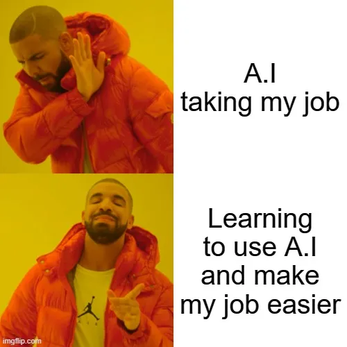

## AI policy

{width="100px" fig-align="center"}

## learning is like going to the gym

Nobody needs 60 kg moved from the floor to your chest. The weight goes up, then it goes back down. The only thing a workout produces is *you*, and the effort is where that happens. That is why sending an android to the gym in your place would be preposterous: even if it performs the perfect rep, you gain nothing.

Learning is like going to the gym. Nobody needs your smoothing plot or your ACF graph. Their only value is what making them builds in you: the mental model of how the method works, and the instinct to say "wait, that can't be right" when a result looks off. Handing your homework to an AI is sending the android to lift for you.

This does not mean AI is the enemy. A good spotter or coach makes you stronger: they catch your mistakes, push you past a sticking point, and tell you what you did wrong. **Use AI as a spotter, not as the person lifting.**

## keep the good friction

Most of the technology around you is built to remove friction. In this course we keep some of it on purpose. Researchers have recently argued that friction, the experience of difficulty while pursuing a goal, is what makes learning stick and effort meaningful, and that AI is unusual because it removes the useful friction together with the pointless kind [Zohar, Bloom, and Inzlicht, 2026](https://www.nature.com/articles/s44271-026-00402-1){target="_blank"}. A chairlift and a trail can reach the same summit, but only one of them gets you fit.

So the question to ask yourself is: **what kind of friction is this?**

::: {.alert .alert-info}
**Pointless friction: let the AI help, no guilt.** Installing a package, an obscure error message, remembering the name of a plotting argument, formatting a date, making a legend look nice.

**Productive friction: stay in the struggle.** A graph that contradicts your expectation, a bug you can't explain, choosing a window size, deciding whether a point is an outlier, explaining *why* a method does what it does.

*A simple test:* if a question about it could appear on an exam, it is productive friction.
:::

## the rules

1. **AI is welcome in the homework.** Use any tool you like. Ask it what each part of the code means; copy-pasting blindly is unacceptable. You are here to learn.
2. **Predict before you run.** When a question asks "what happens if...", write down your prediction *before* running the code or asking an AI. Even a wrong prediction is valuable. A surprise is where the learning happens.
3. **Declare your AI use.** At the end of each assignment, add a line or two: which tool you used, and what you used it for.
4. **You must be able to explain every line you submit.** I may ask you about any part of your work.
5. **Exams are without AI.** The mini exams are done in the classroom, without computers, and their questions are variations of what you did at home. Homework is the training; the exam is the match. If an AI did your training, it will show.

Ultimately, you, the student, are responsible for your work and for what you learn.

### prompts that help you learn

Paste one of these at the start of a conversation with your favorite AI. Feel free to adapt them.

**The tutor**

> You will play the role of a tutor. Your job is to help me learn: ask me questions and guide me. Don't give me the answers. Help me build a mental model so I can grow and flourish.

**Predict first**

> Before you show me any result or code, ask me what I expect to happen and why. Only then reveal it, and help me understand any gap between my expectation and reality.

**Explain it back**

> I'm going to paste my code. Don't fix it. Ask me what each part does, and correct my misunderstandings.

**The hint ladder**

> My code gives [this error / this strange graph]. Give me one small hint at a time, starting with the vaguest one. Don't write the fix unless I ask.

**Conceptual or mechanical?**

> Before helping, tell me whether my problem is conceptual or mechanical. If it is mechanical (syntax, installation, formatting), just fix it. If it is conceptual, coach me and don't give me the answer.

**The skeptic**

> Here is the solution you gave me. What assumptions does it make? How could it be wrong for my data? Help me check it, instead of telling me it's fine.

**Quiz me**

> Quiz me on [topic], one question at a time, based on graphs that you describe to me. Don't give hints until I answer. I want to practice interpreting results, not memorizing formulas.

**Know your level**

> I'm a graduate student in environmental sciences with only a basic Python course behind me. Explain things at that level, with examples from my field.

::: {.alert .alert-warning}
**Tip:** after a few messages, AIs tend to drift back to giving you the answer. When that happens, just remind it: *"Remember, don't give me the answer."*
:::

{fig-align="center"}

*The earlier version of this policy was adapted from [Ethan Mollick's ideas on AI in the classroom](https://oneusefulthing.substack.com/p/all-my-classes-suddenly-became-ai){target="_blank"}.*
