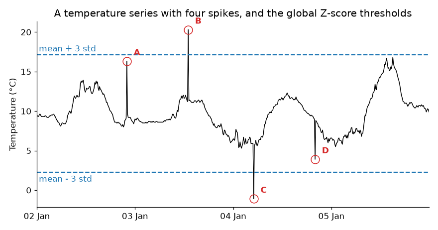
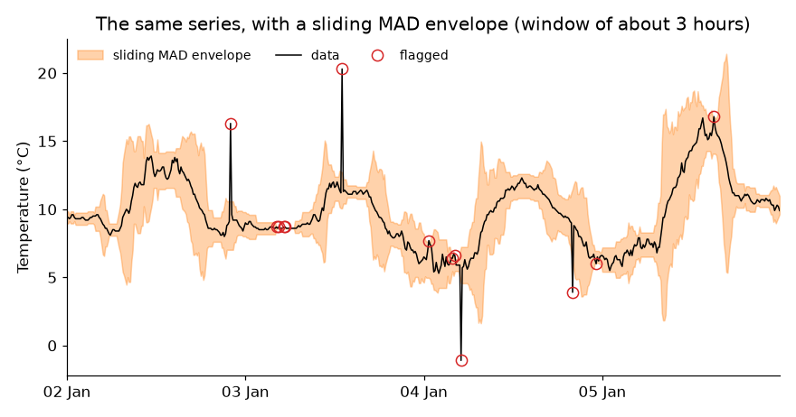

## HW: outliers

This homework comes right after the third session, where we discussed outliers and missing values. Read all the instructions before you start.

::: {.alert .alert-info}
##### why homework? {.unnumbered}

This is where you build intuition: you will play with parameters and get surprised by what the data tells you. Doing the homework is **essential to prepare for the exams**. In the exams there will be no computations. I will show you graphs and ask you to sketch and analyze them, and the questions will be variations of what you do here. Homework is the training, the exam is the match.

Read the [AI policy](/basics/AI-policy.html) before you start. AI is welcome here, but **write your prediction before you run the code or ask an AI**.
:::

::: {.alert .alert-warning}
##### where to spend your time {.unnumbered}

Not all effort is equal. For every obstacle you meet, ask yourself: is this **productive friction** or **pointless friction**?

- *Productive:* sketching what you expect to see, understanding why a method failed, working out what a result means.
- *Pointless:* fighting with axis labels, colors or tick formats, an obscure error message, remembering the name of an argument.

Spend your time on the first kind, and get help for the second (AI, a classmate, a quick search). A clear graph is enough, nobody needs a beautiful one. If you have been stuck on the same cosmetic detail for 15 minutes, move on.
:::

## the data

Use the station and the year of the previous homeworks. You will work with the temperature of **10 consecutive days**, with no gaps and with clear daily cycles (a winter month, for example. A very flat period makes this homework less interesting).

Real data does not come with a label saying where the problems are, so **I will add the problems myself**. The template adds to your temperature 12 spikes, 3 codes of "no data" (-9999) and a sensor that gets stuck, all in random places. Because we know exactly where they are, you will be able to **score** every method you try. Use the last digits of your ID number as the `seed`, so that everybody gets different problems.

Download this <a href="/homework/HW-outliers-template.ipynb" download>Jupyter Notebook template</a>. It loads the data and adds the problems for you. Do not peek at `truth` or `temp_original` until a task tells you to.

## how to work

For every graph below, do these three steps, in this order:

1. **Predict.** Before running anything, **sketch on paper** what you expect to see (a quick sketch, not a work of art), and describe it in one or two sentences in the notebook. The exam will ask you to sketch, so this is training.
2. **Run.** Make the graph.
3. **Explain.** Compare what you got with what you predicted. If you were surprised, find out why.

A wrong prediction is not a mistake, it is where the learning happens. Please do not edit your prediction after the fact.

## part 1: common sense first

Plot `temp_bad`, the temperature with the problems.

- **Predict:** how many of the problems can you see by eye? Where would you draw the lower and upper limits of visual inspection?
- **Explain:** what is wrong with the graph? What did the code "no data" do to it?

Now use common sense, not statistics:

1. Find the values that are physically impossible, and put NaN in their place.
1. Find the stuck sensor, using the function `conseq_series` from the challenge (it is already in the template). Use `N = 20`.
1. Make a new series, `temp_clean`, without these two problems.

Compare the mean and the standard deviation of `temp_bad` and `temp_clean`.

- **Explain:** what did the -9999 do to the mean and to the standard deviation? What do you think the Z-score method would have found, if you had used it on `temp_bad`? Check it. How many of the problems of `truth` did your common sense checks find?

<details>
<summary>hint</summary>
```{.python}
nodata = ~temp_bad.between(-30, 60)      # True where the value is not physically possible

plateaus = conseq_series(temp_bad.mask(nodata), 20)    # NaN where 20 or more values in a row are equal
stuck = plateaus.isna() & temp_bad.mask(nodata).notna()

temp_clean = temp_bad.mask(nodata | stuck)
```
</details>

## part 2: global methods

Use the **Z-score** method (threshold of 3) and the **IQR** method (1.5) on `temp_clean`, with the mean, the standard deviation and the quartiles of the whole series. Plot the series with the thresholds as horizontal lines, and mark the points that were found.

- **Predict:** sketch the series and the thresholds. How many of the 12 spikes will each method find?
- **Explain:** use the function `score` (it is in the template) to count the spikes found, the spikes missed and the false alarms. Were you right? Why do these methods fail in this series? Remember the non-stationary series of the lecture.

<details>
<summary>hint</summary>
```{.python}
z = (temp_clean - temp_clean.mean()) / temp_clean.std()
found_z = z.abs() > 3

q1, q3 = temp_clean.quantile(0.25), temp_clean.quantile(0.75)
found_iqr = (temp_clean < q1 - 1.5 * (q3 - q1)) | (temp_clean > q3 + 1.5 * (q3 - q1))

score(found_z)      # (spikes found, spikes missed, false alarms)
```
</details>

## part 3: sliding windows

Write three functions, one for each method, that receive a series and return `True` where there is an outlier: `rolling_zscore_outliers(series, window, k)`, `rolling_iqr_outliers(series, window, k)` and `rolling_mad_outliers(series, window, k)`. Use centered windows. Save them in a file, you will want to use them again.

Use them on `temp_clean`, with a window of 19 points (about 3 hours), and `k` equal to 3, 1.5 and 3, respectively. Plot two days, with the points that were found.

- **Predict:** which method will find the most spikes? Which one will have more false alarms? Which one is more affected by the spikes themselves?
- **Explain:** use `score` for the three methods. Were you right? What are the false alarms? Did any of the methods find the stuck sensor? Why not?

<details>
<summary>hint</summary>
For the IQR and the MAD you need rolling statistics:
```{.python}
r = series.rolling(window, center=True, min_periods=1)
q1 = r.quantile(0.25)                   # first quartile of each window

def mad(x):
    return np.median(np.abs(x - np.median(x)))
mad_window = r.apply(mad, raw=True)     # MAD of each window
# remember: the MAD threshold is the median +- k * 1.4826 * MAD
```
</details>

**What if...** you change the window to 5 and 73 points, and the thresholds to other values? Make a table with the number of spikes found, missed and false alarms, for the three methods, different windows and different thresholds.

- **Explain:** what did you learn from this table? What happens with a very short window? And with a very long one? Is there a setting that finds all the spikes with no false alarms?

<details>
<summary>hint</summary>
```{.python}
methods = {'Z-score': (rolling_zscore_outliers, [2, 3, 5]),
           'IQR': (rolling_iqr_outliers, [1.5, 3, 5]),
           'MAD': (rolling_mad_outliers, [3, 5, 8])}
rows = []
for name, (function, thresholds) in methods.items():
    for window in [5, 19, 73]:
        for k in thresholds:
            found, missed, false_alarms = score(function(temp_clean, window, k))
            rows.append({'method': name, 'window': window, 'k': k,
                         'found': found, 'missed': missed, 'false alarms': false_alarms})
table = pd.DataFrame(rows)
```
</details>

## part 4: repair

Now we have a list of problems, and we have to decide what to do. Take the points found by your best method, put NaN in their place (together with the "no data" codes and the stuck sensor), and fill the gaps with **linear interpolation**. Since you have `temp_original`, you can check how well you repaired the data.

- **Predict:** where will the repair be good, and where will it be bad?
- **Explain:** plot the repaired series and the original, around a spike and around the stuck sensor. Compute the mean absolute error in three places: at the spikes that you found (and the "no data" codes), at the spikes that you missed, and at the stuck sensor. Which error is the smallest, and which is the largest? Why? Does the error at the stuck sensor depend on the time of the day in which it got stuck? What does this tell you about filling gaps?

<details>
<summary>hint</summary>
```{.python}
found = rolling_mad_outliers(temp_clean, 19, 3)
temp_repaired = temp_clean.mask(found).interpolate()

error = (temp_repaired - temp_original).abs()
error[(truth['spike'] & found) | truth['no_data']].mean()   # spikes that were found, and codes of "no data"
error[truth['spike'] & ~found].mean()                       # spikes that were missed (NaN if you missed none!)
error[truth['stuck']].mean()                                # stuck sensor
```
</details>

## part 5: think like in the exam

Answer in your own words, in a few sentences each. When asked to sketch, do it on paper, and describe your sketch in the notebook. Keep your own graphs at hand as evidence.

1. The graph below shows a temperature series with four spikes, A to D, and the thresholds of the global Z-score method (the mean plus or minus 3 standard deviations). Which spikes will the method find? Why not the others? Sketch where the thresholds of a method with a sliding window would be, and say which spikes it would find.

    {width="85%"}

1. The orange band below is the envelope of a sliding MAD method, for the same series. Why is the band so narrow during the night of 2 to 3 January, and so wide on 5 January? What does it mean for our chances of finding a spike of 3 °C in each of these places? Some points that are not A to D were also flagged. Are they necessarily errors of the method?

    {width="85%"}

1. A colleague generates 10,000 random numbers from a gaussian distribution, removes all the points with a Z-score larger than 3, and says: "I removed the outliers". What is wrong with this?
1. A signal is flat, equal to 0, except for a single point with the value 10 (a spike). Sketch the result of a sliding mean and of a sliding median, both with a window of 5 points. Which of the two would you use before computing a trend, and why?
1. You have 10 years of hourly temperature of a weather station, and you want to clean it automatically. Describe your plan, in order. What would you check before using any statistics?
1. You found an outlier. List the options of what to do with it, and give an example of a situation in which you would choose each one. Why is it important to keep the raw data?

## bonus

Optional, for the curious. Choose one:

- How small can a spike be, and still be found? Make spikes of different sizes (in units of the standard deviation of the series), and plot the fraction found as a function of their size, for a global and for a sliding method.
- Do the same analysis on another variable of your station, relative humidity, for example. What are its physical limits?
- Apply your functions to a column of one of the datasets of the challenge (`cleaning1`, `cleaning2` or `cleaning3`).

## guidelines

A graph is good enough when it has:

1. a title, and named axes with units;
1. readable tick labels;
1. a legend, if there is more than one line;
1. a size that lets you see everything clearly.

## AI declaration

At the end of your notebook, write a line or two: which AI tools you used, and what you used them for.
