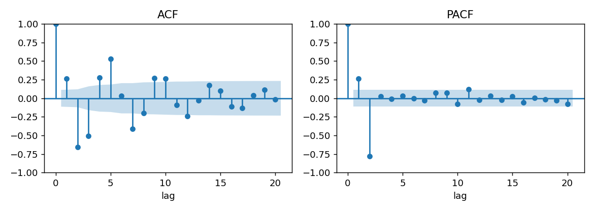
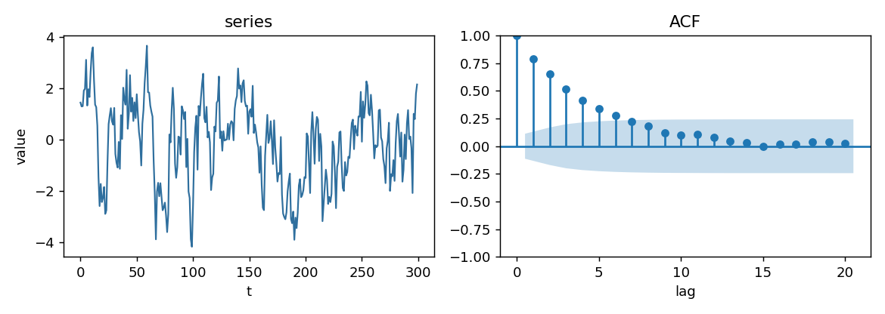

## HW: stationarity

This homework comes right after the sessions on stationarity, AR processes and the autocorrelation
function. Read all the instructions before you start.

::: {.alert .alert-info}
##### why homework? {.unnumbered}

This is where you build intuition: you will play with parameters and get surprised by what the
data tells you. Doing the homework is **essential to prepare for the exams**. In the exams there
will be no computations. I will show you a series or an ACF/PACF graph and ask you to reason about
it, and the questions will be variations of what you do here. Homework is the training, the exam
is the match.

Read the [AI policy](/basics/AI-policy.html) before you start. AI is welcome here, but **write
your prediction before you run the code or ask an AI**.
:::

::: {.alert .alert-warning}
##### where to spend your time {.unnumbered}

Not all effort is equal. For every obstacle you meet, ask yourself: is this **productive
friction** or **pointless friction**?

- *Productive:* sketching what you expect a process to look like, understanding why a series
  behaves the way it does, working out what a graph is telling you.
- *Pointless:* fighting with axis labels, colors or tick formats, an obscure error message,
  remembering the name of an argument.

Spend your time on the first kind, and get help for the second (AI, a classmate, a quick search).
A clear graph is enough, nobody needs a beautiful one. If you have been stuck on the same
cosmetic detail for 15 minutes, move on.
:::

## the data

Most of this homework uses **simulated** series, not real measurements. This is on purpose: when
we generate the series ourselves, we know exactly which process produced it, so we can check our
reasoning against the truth. Use the last digits of your ID number as the `seed`, so everybody
gets a different mystery process in part 5.

One part reuses the temperature of the station and year from the previous homeworks (the same 10
consecutive days is fine).

Download this <a href="/homework/HW-stationarity-template.ipynb" download>Jupyter Notebook
template</a>. It already has the simulators you need.

## how to work

For every graph below, do these three steps, in this order:

1. **Predict.** Before running anything, **sketch on paper** what you expect to see (a quick
   sketch, not a work of art), and describe it in one or two sentences in the notebook. The exam
   will ask you to reason this way, so this is training.
2. **Run.** Make the graph.
3. **Explain.** Compare what you got with what you predicted. If you were surprised, find out why.

A wrong prediction is not a mistake, it is where the learning happens. Please do not edit your
prediction after the fact.

## part 1: noise that forgets, and noise that doesn't

Simulate a white noise series and a random walk, both of length 500, using the same underlying
random draws (the template shows you how).

- **Predict:** which one will stay close to a fixed level, and which one will wander off? If you
  simulated a much longer series, would the mean and the variance of each one settle down to a
  fixed value, or keep changing?
- **Explain:** compute the mean and the variance of each series using only its first half, and
  again using only its second half. For which series are they close? Which of the three
  conditions of weak stationarity does the random walk fail, and why?

**What if...** you plot five different realizations of white noise together, and five different
realizations of a random walk together (same length, different seeds)? Describe the difference
between the two bundles of lines.

<details>
<summary>hint</summary>
```{.python}
rng = np.random.default_rng(seed)
noise = rng.normal(size=500)
walk = noise.cumsum()
```
</details>

## part 2: AR(1), one knob that controls everything

Simulate an AR(1) process, $X_t = \phi X_{t-1} + \varepsilon_t$, for several values of $\phi$:
$-0.9$, $-0.5$, $0$, $0.5$, $0.9$, $0.99$, $1.0$, and $1.05$. Use the same sequence of noise draws
for all of them, so the only thing that changes is $\phi$.

- **Predict:** sketch what you expect each series to look like. Which ones do you expect to look
  "flat and jittery," which ones "smooth and wandering," and which one to blow up?
- **Explain:** were you right? Increase $\phi$ in small steps starting from 0.9. Around which
  value does the series stop being bounded? Does this match what you read in the stationarity
  chapter about the limit on $\phi$? What is special, in this series, about $\phi=0$ and
  $\phi=1$?

**What if...** you compare $\phi=0.9$ with $\phi=-0.9$? Both describe "strong memory," but the
series look very different. Describe the difference, and explain it in terms of what happens
when you multiply a point by $\phi$ to get the next one.

<details>
<summary>hint</summary>
```{.python}
def simulate_ar(phis, n, seed):
    """phis is a list: [phi1] for AR(1), [phi1, phi2] for AR(2), etc."""
    rng = np.random.default_rng(seed)
    p = len(phis)
    eps = rng.normal(size=n)
    x = list(eps[:p])
    for t in range(p, n):
        x.append(eps[t] + sum(phi * x[t - 1 - i] for i, phi in enumerate(phis)))
    return pd.Series(x)
```
</details>

## part 3: the autocorrelation function, by hand

Write your own function `acf_manual(series, max_lag)` that implements the formula from the
chapter,
$$
\hat\rho_{XX}(\tau) = \frac{\sum_t (x_t-\bar x)(x_{t+\tau}-\bar x)}{\sum_t (x_t - \bar x)^2},
$$
and returns the values for $\tau = 0, 1, \dots, \text{max\_lag}$.

Use it on four of the series from parts 1 and 2: white noise, AR(1) with $\phi=0.3$, AR(1) with
$\phi=0.8$, and AR(1) with $\phi=-0.8$.

- **Predict:** before running your function, sketch what you expect each of the four ACFs to look
  like.
- **Explain:** were you right? For the two positive-$\phi$ cases, plot $\phi(\tau)$ on top of
  your empirical ACF. Do they line up? What does a negative $\phi$ do to the ACF, compared to a
  positive one of the same size?

**What if...** you compute the ACF of the random walk from part 1? What does it look like, and
why doesn't it decay the way the AR(1) ones do?

<details>
<summary>hint</summary>
```{.python}
def acf_manual(series, max_lag):
    x = series.values
    mu = x.mean()
    denom = ((x - mu) ** 2).sum()
    rhos = []
    for tau in range(max_lag + 1):
        num = ((x[:len(x) - tau] - mu) * (x[tau:] - mu)).sum()
        rhos.append(num / denom)
    return np.array(rhos)
```
</details>

## part 4: AR(2), two lags of memory

Simulate AR(2) processes, $X_t = \phi_1 X_{t-1} + \phi_2 X_{t-2} + \varepsilon_t$, for these three
pairs: $(\phi_1,\phi_2) = (0.5, -0.8)$, $(\phi_1,\phi_2)=(1.8,-0.92)$, and
$(\phi_1,\phi_2)=(0.6,0.3)$.

- **Predict:** sketch what you expect each series and its ACF to look like.
- **Explain:** were you right? Which of the three pairs give a series that oscillates, and which
  one just decays smoothly? For the two oscillating ones, is the oscillation faster or slower?
  Does the ACF oscillate the same way the series does?

**What if...** you keep $\phi_1=1.8$ fixed and slowly change $\phi_2$ from $-0.92$ towards $-1.1$
in small steps? At some point the series stops being bounded. Make a small table: for each
$\phi_2$ you tried, does the simulated series stay bounded (say, below 10 times its starting
scale) after 300 steps, or does it blow up? Just map out, empirically, where the line is — you
don't need the characteristic roots to do this, only the simulation.

<details>
<summary>hint</summary>
```{.python}
def stays_bounded(phis, n=300, seed=0, limit=10):
    x = simulate_ar(phis, n, seed)
    return x.abs().max() < limit * x.iloc[:5].abs().max()
```
</details>

## part 5: finding the order

### the noise floor

Simulate an AR(1) with $\phi=0.7$ and length 300. Use `statsmodels`' `plot_acf` with a 95%
confidence band (as in the lecture notes).

- **Predict:** roughly at which lag do you expect the ACF to first enter the band and stay
  inside it?
- **Explain:** were you right? Compare that lag to the lag at which $\phi(\tau)$ drops below, say,
  0.1. Do the two numbers tell a similar story?

### the mystery process

The template has a function `mystery_series(seed)`. It returns a series generated by an AR
process whose order (1, 2 or 3) and $\phi$ values are hidden from you. Use your own seed.

- **Predict:** before computing anything, what is the largest order you think an AR process could
  have and still be identified from data alone? Why would a very high order be hard to pin down?
- **Run:** plot the ACF and the PACF of your mystery series (`statsmodels`' `plot_acf` and
  `plot_pacf`). Based on where the PACF cuts off, state the order $p$ you believe generated the
  series.
- **Explain:** now run the `reveal_mystery(seed)` cell. Were you right? If not, look at the PACF
  again: was the last significant bar ambiguous (close to the edge of the confidence band)? What
  does that tell you about how much data you'd need to be more confident?

## part 6: back to your own data

Take the 10 days of temperature you used in previous homeworks. Plot its ACF and PACF.

- **Predict:** given that the data has a clear daily cycle, what do you expect its ACF to look
  like? Roughly after how many lags do you expect the autocorrelation to become hard to
  distinguish from noise?
- **Explain:** were you right? Does the ACF of real temperature look more like one of the clean
  processes from parts 1-4, or like a mix of several? Looking back at the three motivating
  questions from the start of this chapter (how much does now tell you about 10, 100, 1000
  minutes from now?) — what would you now answer, using this ACF as evidence?

## part 7: think like in the exam

Answer in your own words, in a few sentences each. No code is needed for this part, but you can
use your own graphs as evidence.

1. The graph below shows the ACF and PACF of an unlabeled simulated series. What is the most
   likely order of the AR process that generated it? How can you tell from the PACF, and not just
   the ACF?

    {width="85%"}

1. The graph below shows a series and its ACF with a 95% confidence band. At roughly which lag
   would you say the series "forgets" itself — i.e. further lags no longer carry a reliable
   signal? Is this the same as saying the process has no memory at all beyond that lag?

    {width="85%"}

1. A colleague simulates 10,000 iid gaussian numbers (pure white noise, by construction) and
   plots the ACF for 40 lags. Two bars, at lag 7 and at lag 23, happen to cross the 95%
   confidence band. The colleague concludes "there must be a real 7-step and 23-step dependence
   in my random number generator." What is wrong with this reasoning?
1. A series has an upward trend. Explain, using the definition of weak stationarity, why its ACF
   stays close to 1 for a very long range of lags. Does this mean the series has unusually long
   memory, in the sense that matters for forecasting?
1. The autocorrelation function satisfies $\hat\rho_{XX}(\tau) = \hat\rho_{XX}(-\tau)$. Looking at
   the formula for $\hat\rho_{XX}(\tau)$, explain in one or two sentences why this has to be true.
1. Two AR(1) processes have $\phi=0.3$ and $\phi=0.9$ respectively. Sketch, roughly, what each of
   their ACFs looks like on the same axes. Which one would you describe as having a shorter
   "memory," and what does that mean operationally (in terms of the confidence band)?

## bonus

Optional, for the curious. Choose one:

- Run the mystery-process exercise from part 5 again with two or three other seeds. Was the order
  always easy to read off the PACF, or did some seeds give you an ambiguous case? What made it
  ambiguous?
- The autocorrelation chapter mentions a geometric interpretation: the correlation between two
  standardized series is the cosine of the angle between them, viewed as vectors. Take your own
  temperature series and a lagged copy of itself, standardize both, and compute the angle between
  them directly (using the dot product). Compare it to the ACF value you already computed for
  that lag.
- Build your own AR(2) grid search like in part 4, but sweep both $\phi_1$ and $\phi_2$ over a
  2D grid, and make a plot (e.g. a scatter or heatmap) coloring each point by "bounded" or "blew
  up." What shape does the boundary trace out?

## guidelines

A graph is good enough when it has:

1. a title, and named axes with units;
1. readable tick labels;
1. a legend, if there is more than one line;
1. a size that lets you see everything clearly.

## AI declaration

At the end of your notebook, write a line or two: which AI tools you used, and what you used them
for.
