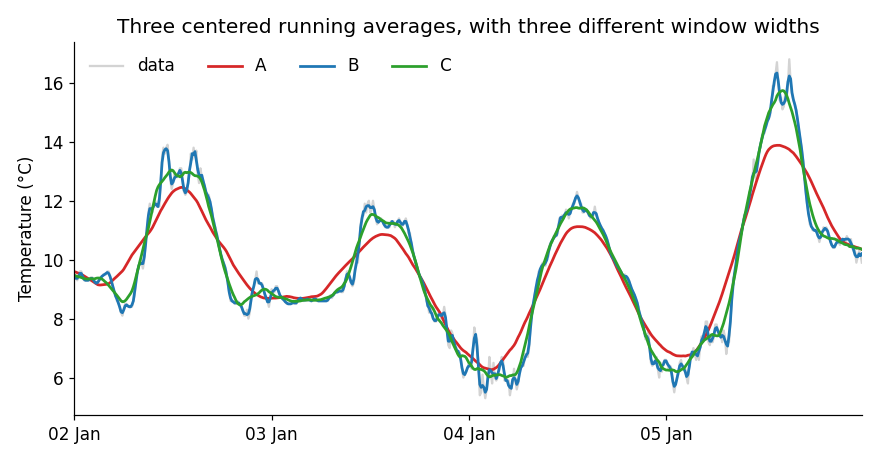
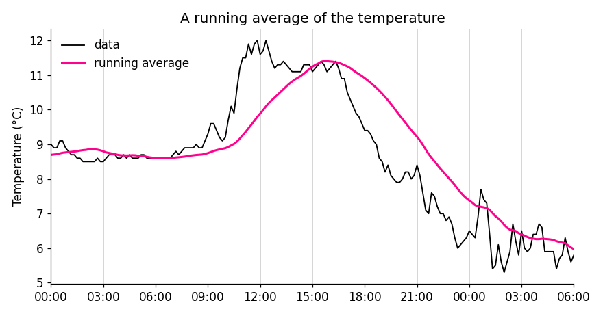

## homework: smoothing

This homework comes right after the second session, where we discussed smoothing. Read all the instructions before you start.

::: {.alert .alert-info}
##### why homework? {.unnumbered}

This is where you build intuition: you will play with parameters and get surprised by what the data tells you. Doing the homework is **essential to prepare for the exams**. In the exams there will be no computations. I will show you graphs and ask you to sketch and analyze them, and the questions will be variations of what you do here. Homework is the training, the exam is the match.

Read the [AI policy](/basics/AI-policy.html) before you start. AI is welcome here, but **write your prediction before you run the code or ask an AI**.
:::

::: {.alert .alert-warning}
##### where to spend your time {.unnumbered}

Not all effort is equal. For every obstacle you meet, ask yourself: is this **productive friction** or **pointless friction**?

- *Productive:* sketching what you expect to see, understanding why the graph surprised you, working out what a result means.
- *Pointless:* fighting with axis labels, colors or tick formats, an obscure error message, remembering the name of an argument.

Spend your time on the first kind, and get help for the second (AI, a classmate, a quick search). A clear graph is enough, nobody needs a beautiful one. If you have been stuck on the same cosmetic detail for 15 minutes, move on.
:::

## the data

Use the station and the year of the [previous homework](/homework/resampling.html). You will work with the temperature of **10 consecutive days**, for example in January or in June. Choose a period without gaps if you can (the template shows you how to check).

Download this <a href="/homework/homework-smoothing-template.ipynb" download>Jupyter Notebook template</a>. It already loads the data for you.

## how to work

For every graph below, do these three steps, in this order:

1. **Predict.** Before running anything, **sketch on paper** what you expect to see (a quick sketch, not a work of art), and describe it in one or two sentences in the notebook. The exam will ask you to sketch, so this is training.
2. **Run.** Make the graph.
3. **Explain.** Compare what you got with what you predicted. If you were surprised, find out why.

A wrong prediction is not a mistake, it is where the learning happens. Please do not edit your prediction after the fact.

## part 1: how wide should the window be?

### three window widths

Plot your 10 days of temperature together with three centered running averages, with windows of 30 minutes, 3 hours and 12 hours.

- **Explain:** what do you gain and what do you lose with each window? Which one would you use to study a cold front that passes in one hour? And to study the daily cycle?

<details>
<summary>hint</summary>
```{.python}
temp = df.loc['2024-01-05':'2024-01-14', 'temperature']
smooth = temp.rolling('3h', center=True).mean()   # the window is defined by time
```
</details>

### a strange experiment

Now plot the data with a centered running average of **24 hours**, and another with **36 hours**.

- **Predict:** a bigger window smooths more. What do you expect the 24-hour curve to look like? And the 36-hour one?
- **Explain:** were you right? Try to understand what you see. Look at the **phase** of the daily cycle, does it have peaks where the data has valleys?

<details>
<summary>hint</summary>
Think about what happens to a perfect daily cycle inside a window. You can test your idea with a perfect sine:
```{.python}
hours = (temp.index - temp.index[0]).total_seconds() / 3600
sine = pd.Series(np.sin(2 * np.pi * hours / 24), index=temp.index)   # period of 24 hours
sine.rolling('24h', center=True).mean()
```
</details>

## part 2: spikes and steps

A running average replaces each point by a weighted average of its neighbors, and the weights are the **kernel**. To see exactly what this does, we will use two artificial signals instead of data: a **spike** (zeros everywhere, except a single 1) and a **step** (zeros, and then ones).

Smooth each of them with a window of 7 points and three kernels: rectangular, triangular and gaussian. Plot the results in two graphs, one for the spike and one for the step, each with three lines.

- **Predict:** sketch what you expect to get, for each kernel. What does a spike become? What does a step become?
- **Explain:** what do you notice about the result of smoothing the spike? Where does the smoothed step begin and end? Which kernel gives the smoothest transition? What does this tell you about how a running average describes a sudden change?

<details>
<summary>hint</summary>
```{.python}
x = np.zeros(41)
x[20] = 1                          # a spike
spike = pd.Series(x)
step = pd.Series((np.arange(41) >= 20).astype(float))   # a step

spike.rolling(7, center=True, win_type='boxcar').mean()       # rectangular
spike.rolling(7, center=True, win_type='triang').mean()       # triangular
spike.rolling(7, center=True, win_type='gaussian').mean(std=1.5)
```
</details>

## part 3: three ways to smooth

Now back to your temperature. Smooth it in three ways, all with the same window of about 3 hours (19 points):

1. a centered running average;
2. a resample, taking the mean every 3 hours;
3. a Savitzky-Golay filter of order 2.

Plot the three of them together with the data, for just two or three days, so you can see the details.

- **Predict:** which one will follow the sharp changes best? Which will be the smoothest? Which one loses resolution?
- **Explain:** were you right? Describe the differences you see.

**What if...** you use the Savitzky-Golay filter with polynomial orders 1, 2, 3 and 4? Plot them together. Some of the curves are the same! Which ones? And one of them is identical to the running average, which one? Check it with numbers, not only with your eyes. Why do you think this happens?

<details>
<summary>hint</summary>
```{.python}
window = 19                                    # points, about 3 hours
temp = temp.interpolate()                      # savgol_filter does not accept NaN

rolling = temp.rolling(window, center=True).mean()
resampled = temp.resample('3h').mean()
resampled.index = resampled.index + pd.Timedelta(hours=1.5)   # resample puts the point at the beginning of the window
savgol = pd.Series(savgol_filter(temp.values, window_length=window, polyorder=2), index=temp.index)

# is the curve of order 1 the same as the running average? compare only the middle of the data, away from the edges
savgol_order1 = savgol_filter(temp.values, window_length=window, polyorder=1)
np.allclose(savgol_order1[window:-window], rolling.values[window:-window])
```
</details>

## part 4: think like in the exam

Answer in your own words, in a few sentences each. When asked to sketch, do it on paper, and describe your sketch in the notebook. Keep your own graphs at hand as evidence.

1. A signal is zero everywhere, except for a single point with value 1 (a spike). Sketch the result of a running average with a window of 5 points, with a rectangular kernel and with a triangular kernel. What is the sum of all values of the result, in each case? Why?
1. Sketch the result of a running average, with a window of 3 points, of a signal that jumps from 0 to 1 (a step). Sketch it again for a window of 7 points. What changes?
1. The graph below shows the temperature (gray) and three centered running averages, A, B and C. Their windows are 30 minutes, 3 hours and 9 hours, in some order. Which is which? How can you tell? If you wanted to study the daily cycle, which one would you use?

    {width="85%"}

1. The pink curve below is a running average of the temperature (black). Is it centered? How can you tell? Estimate the width of the window.

    {width="85%"}

1. During the COVID-19 pandemic, the news showed the 7-day moving average of new cases. Why 7, and not 5 or 10? (Think about the strange experiment of part 1.)
1. You have a signal with narrow, sharp peaks, and you want to get rid of the noise without flattening the peaks. Would you use a running average or a Savitzky-Golay filter? Why? What is the price you pay?

## bonus

Optional, for the curious. Choose one:

- Plot a running average with a band of $\pm 1$ standard deviation of the window, and another band with the 95% confidence interval of the mean. Which band is wider? Which one tells you where the data is?
- Smooth your temperature with a kernel we did not see in class, from [this list](https://docs.scipy.org/doc/scipy/reference/signal.windows.html#module-scipy.signal.windows){target="_blank"}. What does its shape look like, and what does it do to your data?
- A graph of your own invention. Before the graph, write the question that motivated it.

## guidelines

A graph is good enough when it has:

1. a title, and named axes with units;
1. readable tick labels;
1. a legend, if there is more than one line;
1. a size that lets you see everything clearly.

## AI declaration

At the end of your notebook, write a line or two: which AI tools you used, and what you used them for.
