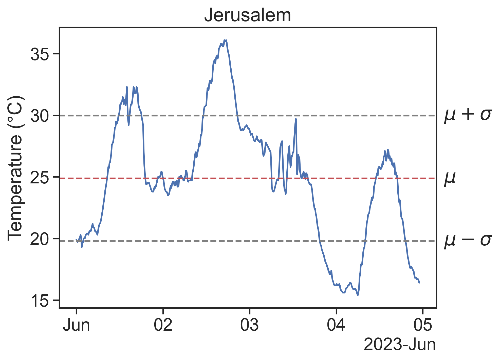
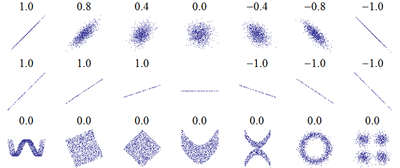

# autocorrelation

In this section, we will make use of a few fundamental concepts from statistics.
Knowing these concepts well is fundamental to make sense of stationarity.

## mean and standard deviation

Let's call our time series $X$, and its length $N$. Then:

$$
\begin{aligned}
\text{mean\qquad}& &\mu &= \frac{\displaystyle\sum_{i=1}^N X_i}{N} \\
&\\
\text{standard deviation\qquad}& &\sigma &= \sqrt{\frac{\displaystyle\sum_{i=1}^N (X_i-\mu)^2}{N}}
\end{aligned}
$$

The mean and standard deviation can be visualized thus:



## expected value

The expected value (or expectation) of a variable $X$ is given by
$$
E[X] = \sum_{i=1}^N X_i p_i.
$$

$p_i$ is the weight or probability that $X_i$ occurs. For a time series, the probability $p_i$ that a given point $X_i$ is in the dataset is simply $1/N$, therefore we can write the following measures in terms of expected values:

::: {.column-margin}
What if my time series clearly has data points with probability greater than $1/N$? For instance, consider this temperature time series, in degrees Celcius:

$$
X = \{21,25,25,20,26,25\}
$$

The value 25 appears in half (3/6) of the samples. Its weight in the equation for the expected value will be $1/N$ counted three times, that is, $3/N$. The probability of each value will automatically be what it needs to be when we use this formula.

:::

* mean, also called 1st moment:
  $$
  \mu = E[X].
  $$
* variance, also called 2nd moment:
  $$
  \sigma^2 = E[(X-E[X])^2] = E[(X-\mu)^2].
  $$
  Of course, $\sigma$ is called the standard deviation.
* you might have heard of the 3rd moment (skewness) and 4th moment (kurtosis), they are also useful sometimes. Higher order moments are not common.

## covariance

The covariance between two time series $X$ and $Y$ is given by

$$
\begin{split}
\text{cov}(X,Y) &= E[(X-E[X])(Y-E[Y])]\\
                &= E[(X-\mu_X)(Y-\mu_Y)]
\end{split}
$$

Compare this to the definition of the variance, and it is obvious that the covariance $\text{cov(X,X)}$ of a time series with itself is its variance.

## correlation

We are almost there. I promise.

The fact that  $\text{cov(X,X)} = \sigma_X^2$ begs us to define a new measure, the correlation:

$$
\text{corr}(X,Y) = \frac{E[(X-\mu_X)(Y-\mu_Y)]}{\sigma_X \sigma_Y}.
$$

This is convenient, because now we can say that the correlation of a time series with itself is $\text{corr}(X,X)=1$.

This is also called the Pearson correlation coefficient, and the result has a value between $1$ and $-1$.



::: {.column-margin}
Source: [Wikimedia](https://commons.wikimedia.org/wiki/File:Correlation_examples.png)
:::

### curious fact 1
Isn't the expression for the correlation suspiciously similar to something we just saw in the last lecture?

Remember that we defined the Z-score of a single data point as
$$
z  = \frac{x-\mu}{\sigma},
$$
where $x$ is a specific data point. If we apply this to every point of the time series $X$, we get a new, standardized series $Z_X$, whose $i$-th element is
$$
Z_{X,i} = \frac{X_i-\mu_X}{\sigma_X}.
$$

Therefore, we can interpret the correlation as the expected value of $Z_X$ times $Z_Y$:

$$
\begin{split}
\text{corr}(X,Y) &= \frac{E[(X-\mu_X)(Y-\mu_Y)]}{\sigma_X \sigma_Y} \\
                 &= E[\frac{X-\mu_X}{\sigma_X}\frac{Y-\mu_Y}{\sigma_Y}] \\
                 & = E[Z_X Z_Y]
\end{split}
$$

The correlation is thus the expected value of the product of standardized time series.

### curious fact 2

There is a *magnificent* geometric interpretation for the correlation of two time series. Take the standardized series $Z_X$ and $Z_Y$, and scale each of them down by $1/\sqrt{N}$:

$$
\vec{a} = \frac{Z_X}{\sqrt{N}}, \qquad \vec{b} = \frac{Z_Y}{\sqrt{N}}.
$$

These are now unit vectors ($|\vec{a}|=|\vec{b}|=1$) in an $N$-dimensional space, because $\sum_i Z_{X,i}^2 = N$ (go ahead, check it from the definition of $\sigma$). The dot product of two vectors is

$$
\vec{a}\cdot\vec{b} = |a|\, |b| \cos(\theta),
$$

::: {.column-margin}
The dot product is the sum of an element-wise multiplication:

$$
\vec{a}\cdot\vec{b} = a_1b_1 + a_2b_2 + \cdots + a_Nb_N
$$
:::

Because $\vec{a}$ and $\vec{b}$ are unit vectors, $\vec{a}\cdot\vec{b}=\cos(\theta)$. But the dot product is also

$$
\vec{a}\cdot\vec{b} = \sum_{i=1}^N \frac{Z_{X,i}}{\sqrt N}\frac{Z_{Y,i}}{\sqrt N} = \frac{1}{N}\sum_{i=1}^N Z_{X,i}Z_{Y,i} = E[Z_X Z_Y] = \text{corr}(X,Y).
$$

So we have

$$
\text{corr}(X,Y) = \cos(\theta).
$$

The correlation between $X$ and $Y$ has to be between $-1$ and $1$ because the cosine of the angle between them is also bounded by these values. Furthermore, when two time series have zero correlation, this means that they are orthogonal ($\theta=\pi/2$) in this $N$-dimensional space. Mind. Blown.

::: {.column-margin}
Note that the standardized series $Z_X$ itself is *not* a unit vector — its norm is $\sqrt{N}$, since $\sum_i Z_{X,i}^2 = N$. It only becomes a unit vector once we also divide by $\sqrt{N}$, as $\vec{a}$ does above.
:::

## autocorrelation

The autocorrelation of a time series $X$ is the answer to the following question:

> if we shift $X$ by $\tau$ units, how similar will this be to the original signal?

In other words:

> how correlated are $X(t)$ and $X(t+\tau)$?

The autocorrelation is expressed as
$$
\rho_{XX}(\tau) = \frac{E\left[ (X_t - \mu)(X_{t+\tau} - \mu) \right]}{\sigma^2}
$$

::: {.column-margin}
In other disciplines, the autocorrelation is simply the autocovariance, i.e., it is not normalized by dividing by $\sigma^2$. In time series it is assumed that the autocorrelation is always normalized, therefore between $-1$ and $1$.
:::


The autocorrelation function $\rho_{XX}(\tau)$ provides a useful measure of the degree of dependence among the values of a time series at different times.

A video is worth a billion words, so let's see the autocorrelation in action:



A few comments:

* The autocorrelation for $\tau=0$ (zero shift) is always 1.
  \[Can you prove this? All the necessary equations are above!\]

## try it yourself

Pick one of the example signals below, then drag the slider to change the shift $\tau$ and watch how the autocorrelation responds. Notice how differently each signal's autocorrelation behaves with the shift.

```{=html}
<div id="acf-lab" class="acf-lab">
  <div class="acf-tabs" role="tablist" aria-label="Choose an example time series"></div>

  <div class="acf-norm-toggle" role="radiogroup" aria-label="Normalization method">
    <span class="acf-norm-label">normalization:</span>
    <button type="button" class="acf-norm-btn" data-mode="overlap" aria-pressed="true">overlap only (&divide; overlap size)</button>
    <button type="button" class="acf-norm-btn" data-mode="biased" aria-pressed="false">zero-pad (&divide; N)</button>
  </div>

  <div class="acf-plots">
    <div class="acf-plot-box">
      <div class="acf-plot-title">signal <span class="acf-blue">X(t)</span> and shifted copy <span class="acf-red">X(t+&tau;)</span></div>
      <canvas class="acf-canvas" id="acf-signal-canvas" width="760" height="190"></canvas>
    </div>
    <div class="acf-plot-box">
      <div class="acf-plot-title">autocorrelation &rho;<sub>XX</sub>(&tau;)</div>
      <canvas class="acf-canvas" id="acf-curve-canvas" width="760" height="190"></canvas>
    </div>
  </div>

  <div class="acf-controls">
    <label for="acf-tau-slider">&tau; = <span id="acf-tau-value">0</span></label>
    <input type="range" id="acf-tau-slider" min="-239" max="239" step="1" value="0">
    <span class="acf-rho-readout">&rho;<sub>XX</sub>(&tau;) = <span id="acf-rho-value">1.000</span></span>
  </div>
</div>

<style>
.acf-lab {
  border: 1px solid #dce4e8;
  border-radius: 12px;
  padding: 1rem 1.25rem 1.25rem;
  margin: 1.5rem 0;
  background: var(--acf-bg, #fafbfc);
  font-family: inherit;
}
@media (prefers-color-scheme: dark) {
  .acf-lab { background: #1e2228; border-color: #333a42; }
}
.acf-tabs {
  display: flex;
  flex-wrap: wrap;
  gap: 0.4rem;
  margin-bottom: 0.9rem;
}
.acf-tab-btn {
  border: 1px solid #c7d0d6;
  background: #fff;
  border-radius: 999px;
  padding: 0.35rem 0.9rem;
  font-size: 0.85rem;
  cursor: pointer;
  color: #2b3440;
}
.acf-tab-btn[aria-selected="true"] {
  background: #2f6f9e;
  border-color: #2f6f9e;
  color: #fff;
}
@media (prefers-color-scheme: dark) {
  .acf-tab-btn { background: #2a2f36; border-color: #454d56; color: #dfe4e8; }
  .acf-tab-btn[aria-selected="true"] { background: #5aa4d8; border-color: #5aa4d8; color: #10151a; }
}
.acf-norm-toggle {
  display: flex;
  align-items: center;
  flex-wrap: wrap;
  gap: 0.4rem;
  margin-bottom: 0.9rem;
}
.acf-norm-label {
  font-size: 0.8rem;
  color: #5a6570;
}
@media (prefers-color-scheme: dark) { .acf-norm-label { color: #a9b2ba; } }
.acf-norm-btn {
  border: 1px solid #c7d0d6;
  background: #fff;
  border-radius: 6px;
  padding: 0.25rem 0.6rem;
  font-size: 0.78rem;
  cursor: pointer;
  color: #2b3440;
}
.acf-norm-btn[aria-pressed="true"] {
  background: #3a3f46;
  border-color: #3a3f46;
  color: #fff;
}
@media (prefers-color-scheme: dark) {
  .acf-norm-btn { background: #2a2f36; border-color: #454d56; color: #dfe4e8; }
  .acf-norm-btn[aria-pressed="true"] { background: #dfe4e8; border-color: #dfe4e8; color: #10151a; }
}
.acf-plots {
  display: grid;
  grid-template-columns: 1fr;
  gap: 0.75rem;
}
.acf-plot-box { width: 100%; }
.acf-plot-title {
  font-size: 0.85rem;
  margin-bottom: 0.25rem;
  color: #4a5560;
}
@media (prefers-color-scheme: dark) { .acf-plot-title { color: #a9b2ba; } }
.acf-blue { color: #2f6f9e; font-weight: 600; }
.acf-red { color: #c0392b; font-weight: 600; }
.acf-canvas {
  width: 100%;
  height: 190px;
  display: block;
  border-radius: 8px;
  background: #fff;
}
@media (prefers-color-scheme: dark) { .acf-canvas { background: #11151a; } }
.acf-controls {
  display: flex;
  align-items: center;
  gap: 0.75rem;
  margin-top: 1rem;
  flex-wrap: wrap;
  font-size: 0.9rem;
}
.acf-controls input[type="range"] { flex: 1 1 260px; }
.acf-rho-readout { font-weight: 600; white-space: nowrap; }
</style>

<script>
(function () {
  const root = document.getElementById("acf-lab");
  if (!root) return;

  const N = 240;
  const MAX_LAG = N - 1;

  function mulberry32(seed) {
    return function () {
      seed |= 0; seed = (seed + 0x6D2B79F5) | 0;
      let t = Math.imul(seed ^ (seed >>> 15), 1 | seed);
      t = (t + Math.imul(t ^ (t >>> 7), 61 | t)) ^ t;
      return ((t ^ (t >>> 14)) >>> 0) / 4294967296;
    };
  }
  function gaussian(rng) {
    const u1 = Math.max(rng(), 1e-9), u2 = rng();
    return Math.sqrt(-2 * Math.log(u1)) * Math.cos(2 * Math.PI * u2);
  }

  function makeSine() {
    const x = new Array(N);
    for (let i = 0; i < N; i++) x[i] = Math.sin((2 * Math.PI * i) / 24);
    return x;
  }
  function makeAR1(phi, seed) {
    const rng = mulberry32(seed);
    const x = new Array(N);
    x[0] = gaussian(rng);
    for (let i = 1; i < N; i++) x[i] = phi * x[i - 1] + gaussian(rng);
    return x;
  }
  function makeTrend() {
    const rng = mulberry32(99);
    const x = new Array(N);
    for (let i = 0; i < N; i++) x[i] = 0.06 * i + 0.6 * gaussian(rng);
    return x;
  }
  function makeSquare() {
    const x = new Array(N);
    for (let i = 0; i < N; i++) x[i] = Math.sign(Math.sin((2 * Math.PI * i) / 24)) || 1;
    return x;
  }
  function makeAR2(phi1, phi2, seed) {
    const rng = mulberry32(seed);
    const x = new Array(N);
    x[0] = gaussian(rng);
    x[1] = phi1 * x[0] + gaussian(rng);
    for (let i = 2; i < N; i++) x[i] = phi1 * x[i - 1] + phi2 * x[i - 2] + gaussian(rng);
    return x;
  }

  const SERIES = [
    { id: "sine", label: "periodic (sine)", gen: makeSine,
      note: "Repeating pattern → autocorrelation oscillates, peaking again whenever τ matches a multiple of the period." },
    { id: "square", label: "periodic (square wave)", gen: makeSquare,
      note: "Still periodic, but not sinusoidal → the autocorrelation is triangular instead of a smooth cosine, yet still repeats with the same period." },
    { id: "ar1-0", label: "AR(1), φ=0 (white noise)", gen: () => makeAR1(0, 42),
      note: "φ=0 means no memory at all → autocorrelation collapses to ~0 for any τ≠0, with just random wiggle around it." },
    { id: "ar1-25", label: "AR(1), φ=0.25", gen: () => makeAR1(0.25, 101),
      note: "Weak memory → the theoretical autocorrelation is φ^|τ| = 0.25^|τ|, so it decays to ~0 within just a few lags." },
    { id: "ar1-50", label: "AR(1), φ=0.5", gen: () => makeAR1(0.5, 102),
      note: "Moderate memory → the autocorrelation decays geometrically as 0.5^|τ|, roughly halving with every extra lag." },
    { id: "ar1-75", label: "AR(1), φ=0.75", gen: () => makeAR1(0.75, 103),
      note: "Strong memory → the autocorrelation decays much more slowly, as 0.75^|τ|, staying noticeably positive for many lags." },
    { id: "ar1-100", label: "AR(1), φ=1 (random walk)", gen: () => makeAR1(1, 55),
      note: "φ=1 is a unit root: the process never forgets, so autocorrelation stays high for a very long range of τ — the non-stationary limit of AR(1)." },
    { id: "ar2-fast", label: "AR(2), fast oscillation", gen: () => makeAR2(0.5, -0.8, 13),
      note: "Two lags of memory with complex characteristic roots of modulus ≈0.89 → autocorrelation oscillates with a short pseudo-period (≈5 steps) while it decays." },
    { id: "ar2-slow", label: "AR(2), slow oscillation", gen: () => makeAR2(1.8, -0.92, 21),
      note: "Same idea, but roots closer to the unit circle (modulus ≈0.96) with a smaller angle → a much longer pseudo-period (≈18 steps) and slower decay." },
    { id: "trend", label: "trend (non-stationary)", gen: makeTrend,
      note: "A drifting mean → autocorrelation stays stubbornly high for a long range of τ, since \"nearby in time\" still means \"nearby in level.\"" },
  ];

  function mean(arr) { return arr.reduce((a, b) => a + b, 0) / arr.length; }
  function variance(arr, mu) { return arr.reduce((a, b) => a + (b - mu) * (b - mu), 0) / arr.length; }

  function autocorr(x, mu, varX, tau, mode) {
    const n = x.length;
    let sum = 0, count = 0;
    for (let i = 0; i < n; i++) {
      const j = i + tau;
      if (j < 0 || j >= n) continue;
      sum += (x[i] - mu) * (x[j] - mu);
      count++;
    }
    if (varX === 0) return 0;
    // "overlap": divide by the number of valid overlapping pairs (N-|tau|).
    // "biased": treat out-of-range terms as zero (they vanish once centered) and
    // divide by the fixed N anyway, which produces the classic decaying/tapered envelope.
    const denom = mode === "biased" ? n : count;
    if (denom === 0) return 0;
    return (sum / denom) / varX;
  }

  const tabsEl = root.querySelector(".acf-tabs");
  const normBtns = [...root.querySelectorAll(".acf-norm-btn")];
  const sigCanvas = document.getElementById("acf-signal-canvas");
  const curveCanvas = document.getElementById("acf-curve-canvas");
  const sigCtx = sigCanvas.getContext("2d");
  const curveCtx = curveCanvas.getContext("2d");
  const slider = document.getElementById("acf-tau-slider");
  slider.min = -MAX_LAG;
  slider.max = MAX_LAG;
  const tauValueEl = document.getElementById("acf-tau-value");
  const rhoValueEl = document.getElementById("acf-rho-value");

  let state = { seriesIdx: 0, tau: 0, x: null, mu: 0, varX: 1, curve: null, mode: "overlap" };

  function noteLine() {
    let el = root.querySelector(".acf-note");
    if (!el) {
      el = document.createElement("div");
      el.className = "acf-note";
      el.style.fontSize = "0.85rem";
      el.style.marginBottom = "0.75rem";
      el.style.color = "#5a6570";
      tabsEl.insertAdjacentElement("afterend", el);
    }
    return el;
  }

  function computeCurve() {
    state.curve = [];
    for (let tau = -MAX_LAG; tau <= MAX_LAG; tau++) {
      state.curve.push(autocorr(state.x, state.mu, state.varX, tau, state.mode));
    }
  }

  function setSeries(idx) {
    state.seriesIdx = idx;
    state.x = SERIES[idx].gen();
    state.mu = mean(state.x);
    state.varX = variance(state.x, state.mu);
    computeCurve();
    state.tau = 0;
    slider.value = 0;
    noteLine().textContent = SERIES[idx].note;
    [...tabsEl.children].forEach((btn, i) => btn.setAttribute("aria-selected", i === idx ? "true" : "false"));
    draw();
  }

  SERIES.forEach((s, i) => {
    const btn = document.createElement("button");
    btn.className = "acf-tab-btn";
    btn.type = "button";
    btn.textContent = s.label;
    btn.setAttribute("role", "tab");
    btn.setAttribute("aria-selected", i === 0 ? "true" : "false");
    btn.addEventListener("click", () => setSeries(i));
    tabsEl.appendChild(btn);
  });

  normBtns.forEach((btn) => {
    btn.addEventListener("click", () => {
      state.mode = btn.dataset.mode;
      normBtns.forEach((b) => b.setAttribute("aria-pressed", b === btn ? "true" : "false"));
      computeCurve();
      draw();
    });
  });

  function setupCanvas(canvas, ctx) {
    const dpr = window.devicePixelRatio || 1;
    const rect = canvas.getBoundingClientRect();
    const w = rect.width || 760, h = 190;
    canvas.width = w * dpr;
    canvas.height = h * dpr;
    ctx.setTransform(dpr, 0, 0, dpr, 0, 0);
    return { w, h };
  }

  function drawSignal() {
    const { w, h } = setupCanvas(sigCanvas, sigCtx);
    const ctx = sigCtx;
    ctx.clearRect(0, 0, w, h);
    const pad = { l: 10, r: 10, t: 14, b: 14 };
    const plotW = w - pad.l - pad.r, plotH = h - pad.t - pad.b;
    const x = state.x;
    const minY = Math.min(...x), maxY = Math.max(...x);
    const range = Math.max(maxY - minY, 1e-6);
    const yAt = (v) => pad.t + plotH - ((v - minY) / range) * plotH;
    const xAt = (i) => pad.l + (i / (N - 1)) * plotW;
    const tau = state.tau;

    // valid-overlap shading
    const i0 = Math.max(0, -tau), i1 = Math.min(N - 1, N - 1 - tau);
    if (i1 > i0) {
      ctx.fillStyle = "rgba(47,111,158,0.08)";
      ctx.fillRect(xAt(i0), pad.t, xAt(i1) - xAt(i0), plotH);
    }

    // zero line
    ctx.strokeStyle = "#d7dde2";
    ctx.beginPath(); ctx.moveTo(pad.l, yAt(state.mu)); ctx.lineTo(w - pad.r, yAt(state.mu)); ctx.stroke();

    // original (blue)
    ctx.strokeStyle = "#2f6f9e";
    ctx.lineWidth = 1.6;
    ctx.beginPath();
    for (let i = 0; i < N; i++) {
      const px = xAt(i), py = yAt(x[i]);
      if (i === 0) ctx.moveTo(px, py); else ctx.lineTo(px, py);
    }
    ctx.stroke();

    // shifted (red): plot X[i+tau] at position i
    ctx.strokeStyle = "#c0392b";
    ctx.lineWidth = 1.6;
    ctx.beginPath();
    let started = false;
    for (let i = 0; i < N; i++) {
      const j = i + tau;
      if (j < 0 || j >= N) continue;
      const px = xAt(i), py = yAt(x[j]);
      if (!started) { ctx.moveTo(px, py); started = true; } else { ctx.lineTo(px, py); }
    }
    ctx.stroke();
  }

  function drawCurve() {
    const { w, h } = setupCanvas(curveCanvas, curveCtx);
    const ctx = curveCtx;
    ctx.clearRect(0, 0, w, h);
    const pad = { l: 34, r: 10, t: 14, b: 20 };
    const plotW = w - pad.l - pad.r, plotH = h - pad.t - pad.b;
    const xAt = (tau) => pad.l + ((tau + MAX_LAG) / (2 * MAX_LAG)) * plotW;
    const yAt = (rho) => pad.t + plotH - ((rho + 1) / 2) * plotH;

    // gridlines at rho = -1, 0, 1
    ctx.strokeStyle = "#e3e8eb";
    ctx.fillStyle = "#8b96a0";
    ctx.font = "10px sans-serif";
    [-1, 0, 1].forEach((v) => {
      const y = yAt(v);
      ctx.beginPath(); ctx.moveTo(pad.l, y); ctx.lineTo(w - pad.r, y); ctx.stroke();
      ctx.fillText(v.toFixed(0), 4, y + 3);
    });

    // tau = 0 vertical
    ctx.strokeStyle = "#e3e8eb";
    ctx.beginPath(); ctx.moveTo(xAt(0), pad.t); ctx.lineTo(xAt(0), h - pad.b); ctx.stroke();

    // curve
    ctx.strokeStyle = "#3a3f46";
    ctx.lineWidth = 1.6;
    ctx.beginPath();
    for (let k = 0; k < state.curve.length; k++) {
      const tau = k - MAX_LAG;
      const px = xAt(tau), py = yAt(state.curve[k]);
      if (k === 0) ctx.moveTo(px, py); else ctx.lineTo(px, py);
    }
    ctx.stroke();

    // current tau marker
    const tau = state.tau;
    const rho = state.curve[tau + MAX_LAG];
    ctx.strokeStyle = "#c0392b";
    ctx.lineWidth = 1.2;
    ctx.beginPath(); ctx.moveTo(xAt(tau), pad.t); ctx.lineTo(xAt(tau), h - pad.b); ctx.stroke();
    ctx.fillStyle = "#c0392b";
    ctx.beginPath(); ctx.arc(xAt(tau), yAt(rho), 4, 0, 2 * Math.PI); ctx.fill();

    tauValueEl.textContent = tau;
    rhoValueEl.textContent = rho.toFixed(3);
  }

  function draw() { drawSignal(); drawCurve(); }

  slider.addEventListener("input", () => {
    state.tau = parseInt(slider.value, 10);
    draw();
  });

  window.addEventListener("resize", draw);

  setSeries(0);
})();
</script>
```
