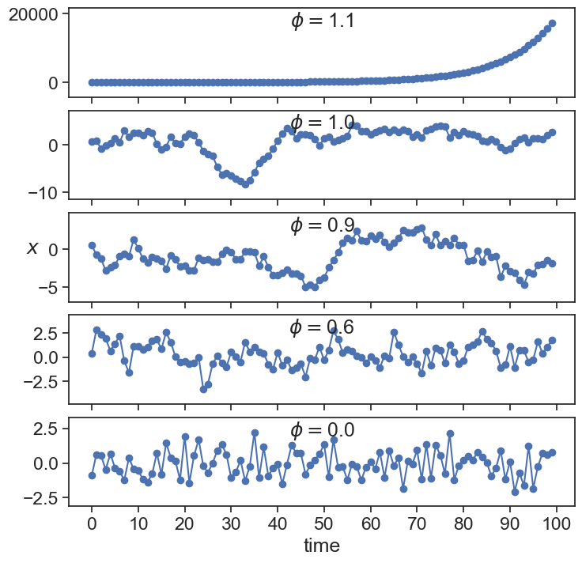
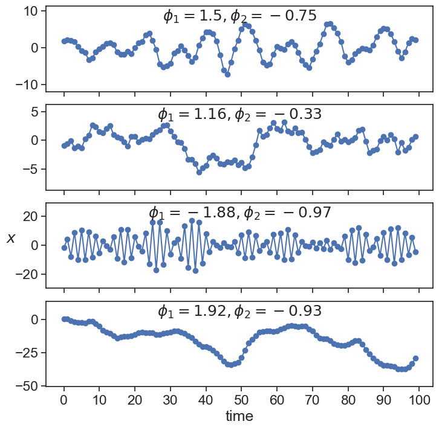
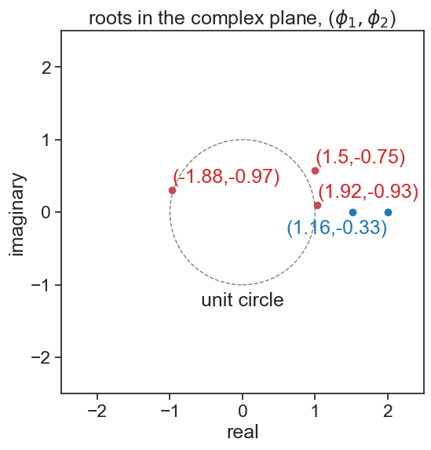

# stationarity

## weak stationarity

A time series is called weakly stationary if the following conditions are met:

1. its mean $\mu$ does not vary in time:
   $$
   \mu_X(t) = \mu_X(t+\tau)
   $$
   for all values of $t$ and $\tau$.
1. its variance is finite for any time $t$:
   $$
   \sigma^2_X(t) < \infty.
   $$
1. The autocorrelation function between two lagged versions of the same time series, $X(t_1)$ and $X(t_2)$, depends only on the difference $\tau=t_2-t_1$.

## strict/strong stationarity

As the name suggests, strict stationarity requires much more than the above. It requires that the joint CDF of two lagged versions of $X$ is the same. It is rare to require such strong terms, we will assume weak stationarity always from now on.

## stationarity of AR(p)

Let's write once more the definition of AR(p):

$$
x_{t} = \phi_1\,x_{t-1} + \phi_2\,x_{t-2} + \cdots + \phi_p\,x_{t-p} + \varepsilon
$$

We can define the **backward shift operator** $B$ as

$$
B X_t = X_{t-1}
$$

Of course, if $B$ is applied $p$ times, it shifts $X$ thus:

$$
B^p X_t = X_{t-p}.
$$

With that in hand, we can rewrite the definition of AR(p) as follows:

$$
x_{t} = \phi_1\, B\,x_t + \phi_2\,B^2\,x_t + \cdots + \phi_p\,B^p\,x_t + \varepsilon
$$

We have many terms with $x_{t}$, so let's group them on the left-hand side:

$$
x_{t}\, \phi(B) = \varepsilon,
$$

where the **characteristic polynomial** $\phi(B)$ is

$$
\phi(B) = 1 - \phi_1\, B - \phi_2\,B^2 - \cdots - \phi_p\,B^p
$$

In order to determine the stationarity of AR(p), we need to find the roots of

$$
\phi(B) = 0,
$$

called characteristic roots. These roots are often complex numbers.

<div class="alert alert-danger">
AR(p) is stationary if ALL the characteristic roots lie OUTSIDE the unit circle.
</div>

::: {.column-margin}
The reason for this is not obvious. A nice explanation can be found in this [StackExchange response](https://quant.stackexchange.com/a/65776). Another good text is @tsay2010analysis[chapter 2].

@davis2016introduction [chapter 2 p. 49 and chapter 3 p. 75] explain that, strictly speaking, an AR(p) process is stationary as long as the roots do not lie on the unit circle. However, in the case that the roots lie **inside** the unit circle, the process is **noncausal**, meaning that the present state depends on future states. In reality, everyone just ignores this point, and simply say that we require the roots to lie outside the unit circle to guarantee stationarity.
:::

## stationarity of AR(1)

We need to solve the roots of the characteristic equation

$$
1 - \phi_1\, B = 0.
$$

The only root is

$$
B = \frac{1}{\phi_1}
$$

Because we require that this root is greater than 1 (in absolute value), we have that:

$$
\left|\frac{1}{\phi_1}\right| > 1\quad \longrightarrow \quad |\phi| < 1.
$$

This result corroborates our conclusion from before:



## stationarity of AR(2)

We need to solve the roots of the characteristic equation

$$
1 - \phi_1 B - \phi_2 B^2 = 0.
$$

For the AR(2) time series from before, here are the roots of the characteristic polynomial plotted on the complex plane:





Because complex roots come in pairs, I plotted above only one of the roots, the one with positive imaginary component. The second panel $(\phi_1=1.16,\phi_2=-0.33)$ has two real roots, so both are plotted in blue.

The AR(2) time series will have a periodic component if the roots are complex, and the frequency of oscillation is

$$
f_0 = \frac{1}{2\pi}\cos^{-1}\left( \frac{\phi_1}{2\sqrt{(-\phi_2)}} \right)
$$

::: {.column-margin}
See an interesting discussion in [David Josephs' excellent time series webpage](https://bookdown.org/josephs_david11/tsReview/ar2-models.html){target="_blank"}
:::

Play with the widget below to get a feel of how the complex roots depend on the values of $\phi_1$ and $\phi_2$. In the left panel you can move the point A to choose different $\phi$ values, and on the right you see the complex roots of the polynomial instantly updated. As long as the point A is inside the blue triangle, the roots will be outside the unit circle, and therefore the process will be stationary. For $\phi_2$ values above (below) the red line, the complex roots will be real (complex conjugates).

<!--
<iframe src="https://www.geogebra.org/classic/wmmsex5v?embed" width="700" height="500" allowfullscreen style="border: 1px solid #e4e4e4;border-radius: 4px;" frameborder="0"></iframe>

::: {.column-margin}
Geogebra app made by Yair Mau (2024)
:::
-->

Here's a version you can play with directly on this page, built the same way, except you can drag in *either* panel: move point **A** on the left to choose $\phi_1,\phi_2$ and watch the root(s) update on the right, or drag a root on the right and watch $\phi_1,\phi_2$ update on the left. Above the red curve the roots are real; below it, they are complex conjugates.

```{=html}
<div id="ar2map-lab" class="ar2map-lab">
  <div class="ar2map-plot-box ar2map-series-box">
    <div class="ar2map-plot-title">a simulated AR(2) realization with these &phi; values</div>
    <div class="ar2map-canvas-wrap">
      <canvas class="ar2map-canvas ar2map-series-canvas" id="ar2map-series-canvas" width="760" height="150"></canvas>
      <div class="ar2map-overlay ar2map-overlay-br">
        <span id="ar2map-status" class="ar2map-badge">stationary</span>
      </div>
    </div>
  </div>
  <div class="ar2map-plots">
    <div class="ar2map-plot-box">
      <div class="ar2map-plot-title">&phi;<sub>1</sub>&ndash;&phi;<sub>2</sub> plane</div>
      <div class="ar2map-canvas-wrap">
        <canvas class="ar2map-canvas" id="ar2map-phi-canvas" width="380" height="320"></canvas>
        <div class="ar2map-overlay ar2map-overlay-tl ar2map-overlay-stack">
          <span>&phi;<sub>1</sub> = <span id="ar2map-phi1">0.500</span></span>
          <span>&phi;<sub>2</sub> = <span id="ar2map-phi2">-0.800</span></span>
        </div>
      </div>
    </div>
    <div class="ar2map-plot-box">
      <div class="ar2map-plot-title">characteristic root(s), complex plane</div>
      <div class="ar2map-canvas-wrap">
        <canvas class="ar2map-canvas" id="ar2map-root-canvas" width="380" height="320"></canvas>
        <div class="ar2map-overlay ar2map-overlay-bc">
          <span>roots: B = <span id="ar2map-rootvalue"></span></span>
        </div>
      </div>
    </div>
  </div>
</div>

<style>
.ar2map-lab {
  border: 1px solid #dce4e8;
  border-radius: 12px;
  padding: 1rem 1.25rem 1.25rem;
  margin: 1.5rem 0;
  background: #fafbfc;
  font-family: inherit;
}
@media (prefers-color-scheme: dark) {
  .ar2map-lab { background: #1e2228; border-color: #333a42; }
}
.ar2map-series-box { margin-bottom: 1rem; }
.ar2map-series-canvas { height: 150px; cursor: default; }
.ar2map-plots {
  display: flex;
  flex-wrap: wrap;
  gap: 1rem;
}
.ar2map-plot-box { flex: 1 1 280px; min-width: 0; }
.ar2map-plot-title {
  font-size: 0.85rem;
  margin-bottom: 0.25rem;
  color: #4a5560;
  text-align: center;
}
@media (prefers-color-scheme: dark) { .ar2map-plot-title { color: #a9b2ba; } }
.ar2map-canvas {
  width: 100%;
  height: 280px;
  display: block;
  border-radius: 8px;
  background: #fff;
  touch-action: none;
  cursor: grab;
}
@media (prefers-color-scheme: dark) { .ar2map-canvas { background: #11151a; } }
.ar2map-canvas-wrap { position: relative; }
.ar2map-overlay {
  position: absolute;
  display: flex;
  gap: 0.6rem;
  align-items: center;
  font-size: 0.85rem;
  pointer-events: none;
  color: #3a3f46;
  white-space: nowrap;
}
@media (prefers-color-scheme: dark) { .ar2map-overlay { color: #dfe4e8; } }
.ar2map-overlay-tl { top: 10px; left: 12px; }
.ar2map-overlay-bc { bottom: 8px; left: 50%; transform: translateX(-50%); }
.ar2map-overlay-br { bottom: 8px; right: 10px; }
.ar2map-overlay-stack { flex-direction: column; align-items: flex-start; gap: 0.15rem; }
.ar2map-badge {
  font-weight: 700;
  border-radius: 999px;
  padding: 0.2rem 0.7rem;
  background: #dff0e2;
  color: #1c6b34;
}
.ar2map-badge.non-stationary {
  background: #fbe1e1;
  color: #a32424;
}
@media (prefers-color-scheme: dark) {
  .ar2map-badge { background: #1f3a28; color: #7fd79a; }
  .ar2map-badge.non-stationary { background: #3a1f1f; color: #e38a8a; }
}
</style>

<script>
(function () {
  const root = document.getElementById("ar2map-lab");
  if (!root) return;

  const phiCanvas = document.getElementById("ar2map-phi-canvas");
  const rootCanvas = document.getElementById("ar2map-root-canvas");
  const seriesCanvas = document.getElementById("ar2map-series-canvas");
  const phiCtx = phiCanvas.getContext("2d");
  const rootCtx = rootCanvas.getContext("2d");
  const seriesCtx = seriesCanvas.getContext("2d");
  const statusEl = document.getElementById("ar2map-status");
  const phi1El = document.getElementById("ar2map-phi1");
  const phi2El = document.getElementById("ar2map-phi2");
  const rootValueEl = document.getElementById("ar2map-rootvalue");

  // phi-plane view bounds
  const PX = { min: -3, max: 3 };
  const PY = { min: -2, max: 2 };
  // complex-plane view bounds
  const CX = { min: -2, max: 2 };
  const CY = { min: -2, max: 2 };

  let phi1 = 0.5, phi2 = -0.8; // matches the "fast oscillation" AR(2) example from the autocorrelation widget
  let dragging = false;

  // Fixed innovations: the same noise realization drives every simulated series, so
  // dragging point A changes only the AR(2) coefficients, not the randomness underneath.
  function mulberry32(seed) {
    return function () {
      seed |= 0; seed = (seed + 0x6D2B79F5) | 0;
      let t = Math.imul(seed ^ (seed >>> 15), 1 | seed);
      t = (t + Math.imul(t ^ (t >>> 7), 61 | t)) ^ t;
      return ((t ^ (t >>> 14)) >>> 0) / 4294967296;
    };
  }
  function gaussian(rng) {
    const u1 = Math.max(rng(), 1e-9), u2 = rng();
    return Math.sqrt(-2 * Math.log(u1)) * Math.cos(2 * Math.PI * u2);
  }
  const N_SIM = 150;
  const DIVERGE_CUTOFF = 50;
  const rngSim = mulberry32(2024);
  const innovations = Array.from({ length: N_SIM }, () => gaussian(rngSim));

  function simulate(p1, p2) {
    const x = [innovations[0]];
    x.push(p1 * x[0] + innovations[1]);
    let diverged = false;
    for (let t = 2; t < N_SIM; t++) {
      const next = p1 * x[t - 1] + p2 * x[t - 2] + innovations[t];
      if (!Number.isFinite(next) || Math.abs(next) > DIVERGE_CUTOFF) { diverged = true; break; }
      x.push(next);
    }
    return { values: x, diverged };
  }

  function setupCanvas(canvas, ctx) {
    const dpr = window.devicePixelRatio || 1;
    const rect = canvas.getBoundingClientRect();
    const w = rect.width || 380, h = rect.height || 280;
    canvas.width = w * dpr;
    canvas.height = h * dpr;
    ctx.setTransform(dpr, 0, 0, dpr, 0, 0);
    return { w, h };
  }

  function makeMapper(w, h, xr, yr, pad) {
    // Use one shared scale for both axes (equal pixels per unit), so circles stay
    // circles and shapes keep their true proportions regardless of the canvas's
    // aspect ratio. Whichever axis is more constraining sets the scale; the other
    // axis gets centered with extra margin.
    const availW = w - 2 * pad, availH = h - 2 * pad;
    const scale = Math.min(availW / (xr.max - xr.min), availH / (yr.max - yr.min));
    const spanPxX = scale * (xr.max - xr.min);
    const spanPxY = scale * (yr.max - yr.min);
    const offX = pad + (availW - spanPxX) / 2;
    const offY = pad + (availH - spanPxY) / 2;
    return {
      xAt: (x) => offX + (x - xr.min) * scale,
      yAt: (y) => offY + spanPxY - (y - yr.min) * scale,
      xInv: (px) => xr.min + (px - offX) / scale,
      yInv: (py) => yr.min + (offY + spanPxY - py) / scale,
    };
  }

  function inTriangle(p1, p2) {
    return (p1 + p2 < 1) && (p2 - p1 < 1) && (p2 > -1) && (p2 < 1);
  }

  function roots(p1, p2) {
    // phi2 * B^2 + phi1 * B - 1 = 0
    const a = p2, b = p1, c = -1;
    if (Math.abs(a) < 1e-6) {
      if (Math.abs(b) < 1e-6) return { type: "none", values: [] };
      return { type: "real", values: [{ re: -c / b, im: 0 }] };
    }
    const D = b * b - 4 * a * c; // = phi1^2 + 4*phi2
    if (D >= 0) {
      const sq = Math.sqrt(D);
      return {
        type: "real",
        values: [
          { re: (-b + sq) / (2 * a), im: 0 },
          { re: (-b - sq) / (2 * a), im: 0 },
        ],
      };
    }
    const re = -b / (2 * a);
    const im = Math.sqrt(-D) / (2 * Math.abs(a));
    return { type: "complex", values: [{ re, im }, { re, im: -im }] };
  }

  function drawPhiPlane() {
    const { w, h } = setupCanvas(phiCanvas, phiCtx);
    const ctx = phiCtx;
    ctx.clearRect(0, 0, w, h);
    const pad = 28;
    const m = makeMapper(w, h, PX, PY, pad);

    // stationarity triangle: vertices (0,1), (2,-1), (-2,-1)
    ctx.beginPath();
    ctx.moveTo(m.xAt(0), m.yAt(1));
    ctx.lineTo(m.xAt(2), m.yAt(-1));
    ctx.lineTo(m.xAt(-2), m.yAt(-1));
    ctx.closePath();
    ctx.fillStyle = "rgba(47,111,158,0.15)";
    ctx.fill();
    ctx.strokeStyle = "#2f6f9e";
    ctx.lineWidth = 1.6;
    ctx.stroke();

    // red parabola: phi2 = -phi1^2/4 (boundary between real and complex roots)
    ctx.beginPath();
    let started = false;
    for (let px1 = PX.min; px1 <= PX.max; px1 += 0.05) {
      const px2 = -(px1 * px1) / 4;
      if (px2 < PY.min) { started = false; continue; }
      const cx = m.xAt(px1), cy = m.yAt(px2);
      if (!started) { ctx.moveTo(cx, cy); started = true; } else { ctx.lineTo(cx, cy); }
    }
    ctx.strokeStyle = "#c0392b";
    ctx.lineWidth = 1.6;
    ctx.stroke();

    // axes
    ctx.strokeStyle = "#c7d0d6";
    ctx.lineWidth = 1;
    ctx.beginPath();
    ctx.moveTo(m.xAt(PX.min), m.yAt(0)); ctx.lineTo(m.xAt(PX.max), m.yAt(0));
    ctx.moveTo(m.xAt(0), m.yAt(PY.min)); ctx.lineTo(m.xAt(0), m.yAt(PY.max));
    ctx.stroke();
    ctx.fillStyle = "#8b96a0";
    ctx.font = "16px sans-serif";
    ctx.fillText("φ₁", m.xAt(PX.max) - 20, m.yAt(0) - 8);
    ctx.fillText("φ₂", m.xAt(0) + 8, m.yAt(PY.max) + 16);

    // point A
    const ax = m.xAt(phi1), ay = m.yAt(phi2);
    ctx.beginPath();
    ctx.arc(ax, ay, 6, 0, 2 * Math.PI);
    ctx.fillStyle = "#c0392b";
    ctx.fill();
    ctx.strokeStyle = "#fff";
    ctx.lineWidth = 1.5;
    ctx.stroke();
    ctx.fillStyle = "#3a3f46";
    ctx.font = "12px sans-serif";
    ctx.fillText("A", ax + 9, ay - 7);

    phiCanvas._mapper = m;
  }

  function drawRootPlane(r) {
    const { w, h } = setupCanvas(rootCanvas, rootCtx);
    const ctx = rootCtx;
    ctx.clearRect(0, 0, w, h);
    const pad = 28;
    const m = makeMapper(w, h, CX, CY, pad);
    rootCanvas._mapper = m;

    // axes
    ctx.strokeStyle = "#c7d0d6";
    ctx.lineWidth = 1;
    ctx.beginPath();
    ctx.moveTo(m.xAt(CX.min), m.yAt(0)); ctx.lineTo(m.xAt(CX.max), m.yAt(0));
    ctx.moveTo(m.xAt(0), m.yAt(CY.min)); ctx.lineTo(m.xAt(0), m.yAt(CY.max));
    ctx.stroke();
    ctx.fillStyle = "#8b96a0";
    ctx.font = "16px sans-serif";
    ctx.fillText("Re", m.xAt(CX.max) - 24, m.yAt(0) - 8);
    ctx.fillText("Im", m.xAt(0) + 8, m.yAt(CY.max) + 16);

    // unit circle
    ctx.beginPath();
    ctx.arc(m.xAt(0), m.yAt(0), m.xAt(1) - m.xAt(0), 0, 2 * Math.PI);
    ctx.strokeStyle = "#3a3f46";
    ctx.lineWidth = 1.6;
    ctx.stroke();

    // always show both roots (both halves of the conjugate pair, or both real roots)
    r.values.forEach((z) => {
      const px = m.xAt(z.re), py = m.yAt(z.im);
      ctx.beginPath();
      ctx.arc(px, py, 6, 0, 2 * Math.PI);
      ctx.fillStyle = "#2f6f9e";
      ctx.fill();
      ctx.strokeStyle = "#fff";
      ctx.lineWidth = 1.5;
      ctx.stroke();
    });
  }

  function drawSeries(sim) {
    const { w, h } = setupCanvas(seriesCanvas, seriesCtx);
    const ctx = seriesCtx;
    ctx.clearRect(0, 0, w, h);
    const pad = { l: 36, r: 10, t: 14, b: 26 };
    const plotW = w - pad.l - pad.r, plotH = h - pad.t - pad.b;
    const vals = sim.values;
    const minY = Math.min(...vals), maxY = Math.max(...vals);
    const range = Math.max(maxY - minY, 1e-6);
    const xAt = (i) => pad.l + (i / (N_SIM - 1)) * plotW;
    const yAt = (v) => pad.t + plotH - ((v - minY) / range) * plotH;

    ctx.strokeStyle = "#d7dde2";
    ctx.beginPath(); ctx.moveTo(pad.l, yAt(0)); ctx.lineTo(w - pad.r, yAt(0)); ctx.stroke();

    ctx.strokeStyle = "#2f6f9e";
    ctx.lineWidth = 1.4;
    ctx.beginPath();
    vals.forEach((v, i) => { const px = xAt(i), py = yAt(v); if (i === 0) ctx.moveTo(px, py); else ctx.lineTo(px, py); });
    ctx.stroke();

    // axis labels
    ctx.fillStyle = "#8b96a0";
    ctx.font = "16px sans-serif";
    ctx.textAlign = "center";
    ctx.fillText("t", pad.l + plotW / 2, h - 6);
    ctx.save();
    ctx.translate(14, pad.t + plotH / 2);
    ctx.rotate(-Math.PI / 2);
    ctx.textAlign = "center";
    ctx.fillText("signal", 0, 0);
    ctx.restore();
    ctx.textAlign = "left";

    if (sim.diverged) {
      ctx.fillStyle = "#a32424";
      ctx.font = "12px sans-serif";
      ctx.fillText("diverges — this point is outside the stationarity triangle", pad.l, pad.t + 10);
    }
  }

  function update() {
    const r = roots(phi1, phi2);
    const stationary = inTriangle(phi1, phi2);

    statusEl.textContent = stationary ? "stationary" : "non-stationary";
    statusEl.classList.toggle("non-stationary", !stationary);
    phi1El.textContent = phi1.toFixed(3);
    phi2El.textContent = phi2.toFixed(3);
    rootValueEl.textContent = !r.values.length ? "—"
      : r.type === "complex" ? `${r.values[0].re.toFixed(3)} ± ${Math.abs(r.values[0].im).toFixed(3)}i`
      : r.values.map((z) => z.re.toFixed(3)).join(",  ");

    drawPhiPlane();
    drawRootPlane(r);
    drawSeries(simulate(phi1, phi2));
  }

  function setFromPhiEvent(evt) {
    const rect = phiCanvas.getBoundingClientRect();
    const px = evt.clientX - rect.left, py = evt.clientY - rect.top;
    const m = phiCanvas._mapper;
    if (!m) return;
    phi1 = Math.min(PX.max, Math.max(PX.min, m.xInv(px)));
    phi2 = Math.min(PY.max, Math.max(PY.min, m.yInv(py)));
    update();
  }

  phiCanvas.addEventListener("pointerdown", (evt) => {
    dragging = true;
    phiCanvas.setPointerCapture(evt.pointerId);
    setFromPhiEvent(evt);
  });
  phiCanvas.addEventListener("pointermove", (evt) => {
    if (dragging) setFromPhiEvent(evt);
  });
  phiCanvas.addEventListener("pointerup", () => { dragging = false; });
  phiCanvas.addEventListener("pointercancel", () => { dragging = false; });

  // Dragging a root is the inverse map. Two cases:
  //  - a complex-conjugate pair: the dragged point is z (its conjugate comes along
  //    for free), phi1 = 2 Re(z)/|z|^2, phi2 = -1/|z|^2.
  //  - two independent real roots: moving one should hold the OTHER one fixed, using
  //    phi1 = (za+zb)/(za*zb), phi2 = -1/(za*zb). Dragging off the real axis smoothly
  //    bifurcates into a complex-conjugate pair (the fixed "other" root is dropped).
  let draggingRoot = false;
  let rootDragOther = null; // fixed real root kept while dragging its partner, or null

  function pointerToComplex(evt) {
    const rect = rootCanvas.getBoundingClientRect();
    const px = evt.clientX - rect.left, py = evt.clientY - rect.top;
    const m = rootCanvas._mapper;
    if (!m) return null;
    return {
      re: Math.min(CX.max, Math.max(CX.min, m.xInv(px))),
      im: Math.min(CY.max, Math.max(CY.min, m.yInv(py))),
    };
  }

  function awayFromZero(v) {
    return Math.abs(v) < 0.05 ? (v < 0 ? -0.05 : 0.05) : v;
  }

  function applyRootDrag(evt) {
    const p = pointerToComplex(evt);
    if (!p) return;
    const REAL_EPS = 0.2;
    if (rootDragOther !== null && Math.abs(p.im) <= REAL_EPS) {
      const za = awayFromZero(p.re), zb = awayFromZero(rootDragOther);
      phi1 = Math.min(PX.max, Math.max(PX.min, (za + zb) / (za * zb)));
      phi2 = Math.min(PY.max, Math.max(PY.min, -1 / (za * zb)));
    } else {
      let re = p.re, im = p.im;
      if (re * re + im * im < 0.04) { // stay away from the origin (division by |z|^2)
        const scale = 0.2 / Math.max(Math.hypot(re, im), 1e-6);
        re *= scale; im *= scale;
      }
      const mod2 = re * re + im * im;
      phi1 = Math.min(PX.max, Math.max(PX.min, (2 * re) / mod2));
      phi2 = Math.min(PY.max, Math.max(PY.min, -1 / mod2));
    }
    update();
  }

  rootCanvas.addEventListener("pointerdown", (evt) => {
    const p = pointerToComplex(evt);
    if (!p) return;
    const m = rootCanvas._mapper;
    const r = roots(phi1, phi2);
    if (r.type === "real" && r.values.length === 2) {
      const d0 = Math.hypot(m.xAt(r.values[0].re) - m.xAt(p.re), m.yAt(0) - m.yAt(p.im));
      const d1 = Math.hypot(m.xAt(r.values[1].re) - m.xAt(p.re), m.yAt(0) - m.yAt(p.im));
      rootDragOther = d0 <= d1 ? r.values[1].re : r.values[0].re;
    } else {
      rootDragOther = null;
    }
    draggingRoot = true;
    rootCanvas.setPointerCapture(evt.pointerId);
    applyRootDrag(evt);
  });
  rootCanvas.addEventListener("pointermove", (evt) => {
    if (draggingRoot) applyRootDrag(evt);
  });
  rootCanvas.addEventListener("pointerup", () => { draggingRoot = false; rootDragOther = null; });
  rootCanvas.addEventListener("pointercancel", () => { draggingRoot = false; rootDragOther = null; });

  window.addEventListener("resize", update);

  update();
})();
</script>
```

<!--
Conversely, play with the position of one of the complex roots, and see how this influences the value of $\phi_1,\phi_2$.

<iframe src="https://www.geogebra.org/classic/dcee44md?embed" width="700" height="500" allowfullscreen style="border: 1px solid #e4e4e4;border-radius: 4px;" frameborder="0"></iframe>

And here's a version of that reverse widget: drag the root $z$ in the right panel (its conjugate $\bar z$ comes along for free), and watch where $(\phi_1,\phi_2)$ lands on the left.

```{=html}
<div id="ar2rev-lab" class="ar2map-lab">
  <div class="ar2map-plot-box ar2map-series-box">
    <div class="ar2map-plot-title">a simulated AR(2) realization with these &phi; values</div>
    <div class="ar2map-canvas-wrap">
      <canvas class="ar2map-canvas ar2map-series-canvas" id="ar2rev-series-canvas" width="760" height="150"></canvas>
      <div class="ar2map-overlay ar2map-overlay-br">
        <span id="ar2rev-status" class="ar2map-badge">stationary</span>
      </div>
    </div>
  </div>
  <div class="ar2map-plots">
    <div class="ar2map-plot-box">
      <div class="ar2map-plot-title">&phi;<sub>1</sub>&ndash;&phi;<sub>2</sub> plane</div>
      <div class="ar2map-canvas-wrap">
        <canvas class="ar2map-canvas" id="ar2rev-phi-canvas" width="380" height="320"></canvas>
        <div class="ar2map-overlay ar2map-overlay-tl ar2map-overlay-stack">
          <span>&phi;<sub>1</sub> = <span id="ar2rev-phi1">0.500</span></span>
          <span>&phi;<sub>2</sub> = <span id="ar2rev-phi2">-0.800</span></span>
        </div>
      </div>
    </div>
    <div class="ar2map-plot-box">
      <div class="ar2map-plot-title">root $z$, complex plane</div>
      <div class="ar2map-canvas-wrap">
        <canvas class="ar2map-canvas" id="ar2rev-root-canvas" width="380" height="320"></canvas>
        <div class="ar2map-overlay ar2map-overlay-bc">
          <span>z = <span id="ar2rev-zvalue"></span></span>
        </div>
      </div>
    </div>
  </div>
</div>

<script>
(function () {
  const root = document.getElementById("ar2rev-lab");
  if (!root) return;

  const phiCanvas = document.getElementById("ar2rev-phi-canvas");
  const rootCanvas = document.getElementById("ar2rev-root-canvas");
  const seriesCanvas = document.getElementById("ar2rev-series-canvas");
  const phiCtx = phiCanvas.getContext("2d");
  const rootCtx = rootCanvas.getContext("2d");
  const seriesCtx = seriesCanvas.getContext("2d");
  const statusEl = document.getElementById("ar2rev-status");
  const phi1El = document.getElementById("ar2rev-phi1");
  const phi2El = document.getElementById("ar2rev-phi2");
  const zValueEl = document.getElementById("ar2rev-zvalue");

  const PX = { min: -3, max: 3 };
  const PY = { min: -2, max: 2 };
  const CX = { min: -2, max: 2 };
  const CY = { min: -2, max: 2 };

  let z = { re: 0.3125, im: 1.0735 }; // matches (φ1,φ2)=(0.5,-0.8), the first widget's default
  let dragging = false;

  function mulberry32(seed) {
    return function () {
      seed |= 0; seed = (seed + 0x6D2B79F5) | 0;
      let t = Math.imul(seed ^ (seed >>> 15), 1 | seed);
      t = (t + Math.imul(t ^ (t >>> 7), 61 | t)) ^ t;
      return ((t ^ (t >>> 14)) >>> 0) / 4294967296;
    };
  }
  function gaussian(rng) {
    const u1 = Math.max(rng(), 1e-9), u2 = rng();
    return Math.sqrt(-2 * Math.log(u1)) * Math.cos(2 * Math.PI * u2);
  }
  const N_SIM = 150;
  const DIVERGE_CUTOFF = 50;
  const rngSim = mulberry32(2024);
  const innovations = Array.from({ length: N_SIM }, () => gaussian(rngSim));

  function simulate(p1, p2) {
    const x = [innovations[0]];
    x.push(p1 * x[0] + innovations[1]);
    let diverged = false;
    for (let t = 2; t < N_SIM; t++) {
      const next = p1 * x[t - 1] + p2 * x[t - 2] + innovations[t];
      if (!Number.isFinite(next) || Math.abs(next) > DIVERGE_CUTOFF) { diverged = true; break; }
      x.push(next);
    }
    return { values: x, diverged };
  }

  function setupCanvas(canvas, ctx) {
    const dpr = window.devicePixelRatio || 1;
    const rect = canvas.getBoundingClientRect();
    const w = rect.width || 380, h = rect.height || 280;
    canvas.width = w * dpr;
    canvas.height = h * dpr;
    ctx.setTransform(dpr, 0, 0, dpr, 0, 0);
    return { w, h };
  }

  function makeMapper(w, h, xr, yr, pad) {
    const availW = w - 2 * pad, availH = h - 2 * pad;
    const scale = Math.min(availW / (xr.max - xr.min), availH / (yr.max - yr.min));
    const spanPxX = scale * (xr.max - xr.min);
    const spanPxY = scale * (yr.max - yr.min);
    const offX = pad + (availW - spanPxX) / 2;
    const offY = pad + (availH - spanPxY) / 2;
    return {
      xAt: (x) => offX + (x - xr.min) * scale,
      yAt: (y) => offY + spanPxY - (y - yr.min) * scale,
      xInv: (px) => xr.min + (px - offX) / scale,
      yInv: (py) => yr.min + (offY + spanPxY - py) / scale,
    };
  }

  function inTriangle(p1, p2) {
    return (p1 + p2 < 1) && (p2 - p1 < 1) && (p2 > -1) && (p2 < 1);
  }

  function phisFromZ(zz) {
    const mod2 = zz.re * zz.re + zz.im * zz.im;
    return { phi1: (2 * zz.re) / mod2, phi2: -1 / mod2 };
  }

  function drawPhiPlane(phi1, phi2) {
    const { w, h } = setupCanvas(phiCanvas, phiCtx);
    const ctx = phiCtx;
    ctx.clearRect(0, 0, w, h);
    const pad = 28;
    const m = makeMapper(w, h, PX, PY, pad);

    ctx.beginPath();
    ctx.moveTo(m.xAt(0), m.yAt(1));
    ctx.lineTo(m.xAt(2), m.yAt(-1));
    ctx.lineTo(m.xAt(-2), m.yAt(-1));
    ctx.closePath();
    ctx.fillStyle = "rgba(47,111,158,0.15)";
    ctx.fill();
    ctx.strokeStyle = "#2f6f9e";
    ctx.lineWidth = 1.6;
    ctx.stroke();

    ctx.beginPath();
    let started = false;
    for (let px1 = PX.min; px1 <= PX.max; px1 += 0.05) {
      const px2 = -(px1 * px1) / 4;
      if (px2 < PY.min) { started = false; continue; }
      const cx = m.xAt(px1), cy = m.yAt(px2);
      if (!started) { ctx.moveTo(cx, cy); started = true; } else { ctx.lineTo(cx, cy); }
    }
    ctx.strokeStyle = "#c0392b";
    ctx.lineWidth = 1.6;
    ctx.stroke();

    ctx.strokeStyle = "#c7d0d6";
    ctx.lineWidth = 1;
    ctx.beginPath();
    ctx.moveTo(m.xAt(PX.min), m.yAt(0)); ctx.lineTo(m.xAt(PX.max), m.yAt(0));
    ctx.moveTo(m.xAt(0), m.yAt(PY.min)); ctx.lineTo(m.xAt(0), m.yAt(PY.max));
    ctx.stroke();
    ctx.fillStyle = "#8b96a0";
    ctx.font = "16px sans-serif";
    ctx.fillText("φ₁", m.xAt(PX.max) - 20, m.yAt(0) - 8);
    ctx.fillText("φ₂", m.xAt(0) + 8, m.yAt(PY.max) + 16);

    const ax = m.xAt(phi1), ay = m.yAt(phi2);
    ctx.beginPath();
    ctx.arc(ax, ay, 6, 0, 2 * Math.PI);
    ctx.fillStyle = "#c0392b";
    ctx.fill();
    ctx.strokeStyle = "#fff";
    ctx.lineWidth = 1.5;
    ctx.stroke();
  }

  function drawRootPlane() {
    const { w, h } = setupCanvas(rootCanvas, rootCtx);
    const ctx = rootCtx;
    ctx.clearRect(0, 0, w, h);
    const pad = 28;
    const m = makeMapper(w, h, CX, CY, pad);
    rootCanvas._mapper = m;

    ctx.strokeStyle = "#c7d0d6";
    ctx.lineWidth = 1;
    ctx.beginPath();
    ctx.moveTo(m.xAt(CX.min), m.yAt(0)); ctx.lineTo(m.xAt(CX.max), m.yAt(0));
    ctx.moveTo(m.xAt(0), m.yAt(CY.min)); ctx.lineTo(m.xAt(0), m.yAt(CY.max));
    ctx.stroke();
    ctx.fillStyle = "#8b96a0";
    ctx.font = "16px sans-serif";
    ctx.fillText("Re", m.xAt(CX.max) - 24, m.yAt(0) - 8);
    ctx.fillText("Im", m.xAt(0) + 8, m.yAt(CY.max) + 16);

    ctx.beginPath();
    ctx.arc(m.xAt(0), m.yAt(0), m.xAt(1) - m.xAt(0), 0, 2 * Math.PI);
    ctx.strokeStyle = "#3a3f46";
    ctx.lineWidth = 1.6;
    ctx.stroke();

    [z, { re: z.re, im: -z.im }].forEach((zz) => {
      const px = m.xAt(zz.re), py = m.yAt(zz.im);
      ctx.beginPath();
      ctx.arc(px, py, 6, 0, 2 * Math.PI);
      ctx.fillStyle = "#2f6f9e";
      ctx.fill();
      ctx.strokeStyle = "#fff";
      ctx.lineWidth = 1.5;
      ctx.stroke();
    });
  }

  function drawSeries(sim) {
    const { w, h } = setupCanvas(seriesCanvas, seriesCtx);
    const ctx = seriesCtx;
    ctx.clearRect(0, 0, w, h);
    const pad = { l: 36, r: 10, t: 14, b: 26 };
    const plotW = w - pad.l - pad.r, plotH = h - pad.t - pad.b;
    const vals = sim.values;
    const minY = Math.min(...vals), maxY = Math.max(...vals);
    const range = Math.max(maxY - minY, 1e-6);
    const xAt = (i) => pad.l + (i / (N_SIM - 1)) * plotW;
    const yAt = (v) => pad.t + plotH - ((v - minY) / range) * plotH;

    ctx.strokeStyle = "#d7dde2";
    ctx.beginPath(); ctx.moveTo(pad.l, yAt(0)); ctx.lineTo(w - pad.r, yAt(0)); ctx.stroke();

    ctx.strokeStyle = "#2f6f9e";
    ctx.lineWidth = 1.4;
    ctx.beginPath();
    vals.forEach((v, i) => { const px = xAt(i), py = yAt(v); if (i === 0) ctx.moveTo(px, py); else ctx.lineTo(px, py); });
    ctx.stroke();

    ctx.fillStyle = "#8b96a0";
    ctx.font = "16px sans-serif";
    ctx.textAlign = "center";
    ctx.fillText("t", pad.l + plotW / 2, h - 6);
    ctx.save();
    ctx.translate(14, pad.t + plotH / 2);
    ctx.rotate(-Math.PI / 2);
    ctx.fillText("signal", 0, 0);
    ctx.restore();
    ctx.textAlign = "left";

    if (sim.diverged) {
      ctx.fillStyle = "#a32424";
      ctx.font = "12px sans-serif";
      ctx.fillText("diverges — this point is outside the stationarity triangle", pad.l, pad.t + 10);
    }
  }

  function update() {
    const { phi1, phi2 } = phisFromZ(z);
    const stationary = inTriangle(phi1, phi2);

    statusEl.textContent = stationary ? "stationary" : "non-stationary";
    statusEl.classList.toggle("non-stationary", !stationary);
    phi1El.textContent = phi1.toFixed(3);
    phi2El.textContent = phi2.toFixed(3);
    zValueEl.textContent = `${z.re.toFixed(3)} ${z.im >= 0 ? "+" : "−"} ${Math.abs(z.im).toFixed(3)}i`;

    drawPhiPlane(phi1, phi2);
    drawRootPlane();
    drawSeries(simulate(phi1, phi2));
  }

  function setFromEvent(evt) {
    const rect = rootCanvas.getBoundingClientRect();
    const px = evt.clientX - rect.left, py = evt.clientY - rect.top;
    const m = rootCanvas._mapper;
    if (!m) return;
    let re = Math.min(CX.max, Math.max(CX.min, m.xInv(px)));
    let im = Math.min(CY.max, Math.max(CY.min, m.yInv(py)));
    if (re * re + im * im < 0.04) { // keep z away from the origin (division by |z|^2)
      const scale = 0.2 / Math.max(Math.hypot(re, im), 1e-6);
      re *= scale; im *= scale;
    }
    z = { re, im };
    update();
  }

  rootCanvas.addEventListener("pointerdown", (evt) => {
    dragging = true;
    rootCanvas.setPointerCapture(evt.pointerId);
    setFromEvent(evt);
  });
  rootCanvas.addEventListener("pointermove", (evt) => {
    if (dragging) setFromEvent(evt);
  });
  rootCanvas.addEventListener("pointerup", () => { dragging = false; });
  rootCanvas.addEventListener("pointercancel", () => { dragging = false; });

  window.addEventListener("resize", update);

  update();
})();
</script>
```
-->

The two roots are easy to find from $\phi_1,\phi_2$, you just need to solve

$$
1 - \phi_1 B - \phi_2 B^2 = 0
$$

for B. What if you choose two roots $z_1,z_2$ and want to derive from them the value of $\phi_1,\phi_2$? Just use this:

$$
\begin{split}
\phi_1 &= \frac{z_1+z_2}{z_1\cdot z_2}\\
& \\
\phi_2 &= -\frac{1}{z_1\cdot z_2}
\end{split}
$$

## stationarity of AR(4)

Conceptually, this is exactly like AR(2). In case you ever need to choose AR(4) $\phi$ values, play with the widget below and see if you can put all the roots outside the unit circle.

<!--
<iframe src="https://www.geogebra.org/classic/xqqffskn?embed" width="700" height="500" allowfullscreen style="border: 1px solid #e4e4e4;border-radius: 4px;" frameborder="0"></iframe>
-->

With four roots there's no simple 2D triangle to draw, but the idea is identical: drag any of the four roots in the complex plane below. Each pair ($z_1,\bar z_1$ or $z_3,\bar z_3$) can be a complex-conjugate pair, or — drag one of them along the real axis — two independent real roots, with the other one in that pair held fixed. Either way, the resulting $\phi_1,\phi_2,\phi_3,\phi_4$ (and whether the process is stationary) update instantly.

```{=html}
<div id="ar4map-lab" class="ar2map-lab">
  <div class="ar2map-plot-box ar2map-series-box">
    <div class="ar2map-plot-title">a simulated AR(4) realization with these &phi; values</div>
    <div class="ar2map-canvas-wrap">
      <canvas class="ar2map-canvas ar2map-series-canvas" id="ar4map-series-canvas" width="760" height="150"></canvas>
      <div class="ar2map-overlay ar2map-overlay-br">
        <span id="ar4map-status" class="ar2map-badge">stationary</span>
      </div>
    </div>
  </div>
  <div class="ar2map-plot-box">
    <div class="ar2map-plot-title">two conjugate root pairs, complex plane</div>
    <div class="ar2map-canvas-wrap">
      <canvas class="ar2map-canvas" id="ar4map-root-canvas" width="760" height="360"></canvas>
      <div class="ar2map-overlay ar2map-overlay-tl ar2map-overlay-stack">
        <span>z<sub>1</sub> = <span id="ar4map-z1">0.000</span></span>
        <span>z<sub>3</sub> = <span id="ar4map-z3">0.000</span></span>
      </div>
      <div class="ar2map-overlay ar2map-overlay-bc">
        <span>&phi; = (<span id="ar4map-phis"></span>)</span>
      </div>
    </div>
  </div>
</div>

<style>
#ar4map-lab .ar2map-plot-box:last-child { flex: 1 1 100%; }
#ar4map-root-canvas { height: 360px; }
</style>

<script>
(function () {
  const root = document.getElementById("ar4map-lab");
  if (!root) return;

  const rootCanvas = document.getElementById("ar4map-root-canvas");
  const seriesCanvas = document.getElementById("ar4map-series-canvas");
  const rootCtx = rootCanvas.getContext("2d");
  const seriesCtx = seriesCanvas.getContext("2d");
  const statusEl = document.getElementById("ar4map-status");
  const z1El = document.getElementById("ar4map-z1");
  const z3El = document.getElementById("ar4map-z3");
  const phisEl = document.getElementById("ar4map-phis");

  const CX = { min: -2.5, max: 2.5 };
  const CY = { min: -2.5, max: 2.5 };

  // Each pair is stored as two explicit roots (not "z and its implied conjugate"),
  // so a pair can independently be a complex-conjugate pair OR two distinct real roots.
  let z1a = { re: 1.4, im: 1.0 }, z1b = { re: 1.4, im: -1.0 };
  let z3a = { re: 1.8, im: 0.4 }, z3b = { re: 1.8, im: -0.4 };
  let dragSlot = null; // "1" or "3"
  let dragIsA = true;

  function mulberry32(seed) {
    return function () {
      seed |= 0; seed = (seed + 0x6D2B79F5) | 0;
      let t = Math.imul(seed ^ (seed >>> 15), 1 | seed);
      t = (t + Math.imul(t ^ (t >>> 7), 61 | t)) ^ t;
      return ((t ^ (t >>> 14)) >>> 0) / 4294967296;
    };
  }
  function gaussian(rng) {
    const u1 = Math.max(rng(), 1e-9), u2 = rng();
    return Math.sqrt(-2 * Math.log(u1)) * Math.cos(2 * Math.PI * u2);
  }
  const N_SIM = 150;
  const DIVERGE_CUTOFF = 50;
  const rngSim = mulberry32(2024);
  const innovations = Array.from({ length: N_SIM }, () => gaussian(rngSim));

  function simulate(phis) {
    const x = [innovations[0]];
    for (let t = 1; t < Math.min(4, N_SIM); t++) {
      let next = innovations[t];
      for (let k = 0; k < t; k++) next += phis[k] * x[t - 1 - k];
      x.push(next);
    }
    let diverged = false;
    for (let t = 4; t < N_SIM; t++) {
      const next = phis[0] * x[t - 1] + phis[1] * x[t - 2] + phis[2] * x[t - 3] + phis[3] * x[t - 4] + innovations[t];
      if (!Number.isFinite(next) || Math.abs(next) > DIVERGE_CUTOFF) { diverged = true; break; }
      x.push(next);
    }
    return { values: x, diverged };
  }

  function setupCanvas(canvas, ctx) {
    const dpr = window.devicePixelRatio || 1;
    const rect = canvas.getBoundingClientRect();
    const w = rect.width || 380, h = rect.height || 280;
    canvas.width = w * dpr;
    canvas.height = h * dpr;
    ctx.setTransform(dpr, 0, 0, dpr, 0, 0);
    return { w, h };
  }

  function makeMapper(w, h, xr, yr, pad) {
    const availW = w - 2 * pad, availH = h - 2 * pad;
    const scale = Math.min(availW / (xr.max - xr.min), availH / (yr.max - yr.min));
    const spanPxX = scale * (xr.max - xr.min);
    const spanPxY = scale * (yr.max - yr.min);
    const offX = pad + (availW - spanPxX) / 2;
    const offY = pad + (availH - spanPxY) / 2;
    return {
      xAt: (x) => offX + (x - xr.min) * scale,
      yAt: (y) => offY + spanPxY - (y - yr.min) * scale,
      xInv: (px) => xr.min + (px - offX) / scale,
      yInv: (py) => yr.min + (offY + spanPxY - py) / scale,
    };
  }

  // Each pair (a,b) contributes its own AR(2)-style factor 1 - P*B - Q*B^2, exactly the
  // same two-roots-to-phi formula as the AR(2) widget: P=(a+b)/(ab), Q=-1/(ab). This works
  // whether a,b are a complex-conjugate pair or two independent real roots. Multiplying the
  // two pairs' factors together gives the full AR(4) polynomial 1-phi1 B-phi2 B^2-phi3 B^3-phi4 B^4.
  function pairToPQ(a, b) {
    const sumRe = a.re + b.re;
    let prodRe = a.re * b.re - a.im * b.im;
    if (Math.abs(prodRe) < 0.0025) prodRe = prodRe < 0 ? -0.0025 : 0.0025;
    return { P: sumRe / prodRe, Q: -1 / prodRe };
  }

  function phisFromPairs(a1, b1, a3, b3) {
    const { P, Q } = pairToPQ(a1, b1);
    const { P: R, Q: S } = pairToPQ(a3, b3);
    const phi1 = P + R;
    const phi2 = Q + S - P * R;
    const phi3 = -(P * S + Q * R);
    const phi4 = -Q * S;
    return [phi1, phi2, phi3, phi4];
  }

  function drawRootPlane() {
    const { w, h } = setupCanvas(rootCanvas, rootCtx);
    const ctx = rootCtx;
    ctx.clearRect(0, 0, w, h);
    const pad = 28;
    const m = makeMapper(w, h, CX, CY, pad);
    rootCanvas._mapper = m;

    ctx.strokeStyle = "#c7d0d6";
    ctx.lineWidth = 1;
    ctx.beginPath();
    ctx.moveTo(m.xAt(CX.min), m.yAt(0)); ctx.lineTo(m.xAt(CX.max), m.yAt(0));
    ctx.moveTo(m.xAt(0), m.yAt(CY.min)); ctx.lineTo(m.xAt(0), m.yAt(CY.max));
    ctx.stroke();
    ctx.fillStyle = "#8b96a0";
    ctx.font = "16px sans-serif";
    ctx.fillText("Re", m.xAt(CX.max) - 24, m.yAt(0) - 8);
    ctx.fillText("Im", m.xAt(0) + 8, m.yAt(CY.max) + 16);

    ctx.beginPath();
    ctx.arc(m.xAt(0), m.yAt(0), m.xAt(1) - m.xAt(0), 0, 2 * Math.PI);
    ctx.strokeStyle = "#3a3f46";
    ctx.lineWidth = 1.6;
    ctx.stroke();

    const pairs = [
      { a: z1a, b: z1b, color: "#2f6f9e", label: "1" },
      { a: z3a, b: z3b, color: "#c0392b", label: "3" },
    ];
    pairs.forEach(({ a, b, color, label }) => {
      [a, b].forEach((z) => {
        const px = m.xAt(z.re), py = m.yAt(z.im);
        ctx.beginPath();
        ctx.arc(px, py, 6, 0, 2 * Math.PI);
        ctx.fillStyle = color;
        ctx.fill();
        ctx.strokeStyle = "#fff";
        ctx.lineWidth = 1.5;
        ctx.stroke();
      });
      ctx.fillStyle = "#3a3f46";
      ctx.font = "12px sans-serif";
      ctx.fillText(label, m.xAt(a.re) + 9, m.yAt(a.im) - 7);
    });
  }

  function drawSeries(sim) {
    const { w, h } = setupCanvas(seriesCanvas, seriesCtx);
    const ctx = seriesCtx;
    ctx.clearRect(0, 0, w, h);
    const pad = { l: 36, r: 10, t: 14, b: 26 };
    const plotW = w - pad.l - pad.r, plotH = h - pad.t - pad.b;
    const vals = sim.values;
    const minY = Math.min(...vals), maxY = Math.max(...vals);
    const range = Math.max(maxY - minY, 1e-6);
    const xAt = (i) => pad.l + (i / (N_SIM - 1)) * plotW;
    const yAt = (v) => pad.t + plotH - ((v - minY) / range) * plotH;

    ctx.strokeStyle = "#d7dde2";
    ctx.beginPath(); ctx.moveTo(pad.l, yAt(0)); ctx.lineTo(w - pad.r, yAt(0)); ctx.stroke();

    ctx.strokeStyle = "#2f6f9e";
    ctx.lineWidth = 1.4;
    ctx.beginPath();
    vals.forEach((v, i) => { const px = xAt(i), py = yAt(v); if (i === 0) ctx.moveTo(px, py); else ctx.lineTo(px, py); });
    ctx.stroke();

    ctx.fillStyle = "#8b96a0";
    ctx.font = "16px sans-serif";
    ctx.textAlign = "center";
    ctx.fillText("t", pad.l + plotW / 2, h - 6);
    ctx.save();
    ctx.translate(14, pad.t + plotH / 2);
    ctx.rotate(-Math.PI / 2);
    ctx.fillText("signal", 0, 0);
    ctx.restore();
    ctx.textAlign = "left";

    if (sim.diverged) {
      ctx.fillStyle = "#a32424";
      ctx.font = "12px sans-serif";
      ctx.fillText("diverges — at least one root is inside the unit circle", pad.l, pad.t + 10);
    }
  }

  function fmtPair(a, b) {
    const isConjPair = Math.abs(a.re - b.re) < 1e-6 && Math.abs(a.im + b.im) < 1e-6 && Math.abs(a.im) > 1e-6;
    if (isConjPair) return `${a.re.toFixed(3)} ± ${Math.abs(a.im).toFixed(3)}i`;
    if (Math.abs(a.im) < 1e-6 && Math.abs(b.im) < 1e-6) return `${a.re.toFixed(3)}, ${b.re.toFixed(3)}`;
    const fmt1 = (z) => `${z.re.toFixed(3)} ${z.im >= 0 ? "+" : "−"} ${Math.abs(z.im).toFixed(3)}i`;
    return `${fmt1(a)}, ${fmt1(b)}`;
  }

  function update() {
    const phis = phisFromPairs(z1a, z1b, z3a, z3b);
    const stationary = [z1a, z1b, z3a, z3b].every((z) => Math.hypot(z.re, z.im) > 1);

    statusEl.textContent = stationary ? "stationary" : "non-stationary";
    statusEl.classList.toggle("non-stationary", !stationary);
    z1El.textContent = fmtPair(z1a, z1b);
    z3El.textContent = fmtPair(z3a, z3b);
    phisEl.textContent = phis.map((p) => p.toFixed(3)).join(", ");

    drawRootPlane();
    drawSeries(simulate(phis));
  }

  function awayFromZero(v) {
    return Math.abs(v) < 0.05 ? (v < 0 ? -0.05 : 0.05) : v;
  }

  function pointerToData(evt) {
    const rect = rootCanvas.getBoundingClientRect();
    const px = evt.clientX - rect.left, py = evt.clientY - rect.top;
    const m = rootCanvas._mapper;
    if (!m) return null;
    return {
      re: Math.min(CX.max, Math.max(CX.min, m.xInv(px))),
      im: Math.min(CY.max, Math.max(CY.min, m.yInv(py))),
    };
  }

  // Dragging a root within a pair mirrors the AR(2) widget's logic exactly, applied to
  // whichever pair (1 or 3) owns the grabbed point: if the OTHER root in that pair is
  // real and you stay close to the real axis, it's held fixed while you move this one
  // independently; otherwise the dragged point becomes a complex root and its partner
  // is its conjugate.
  function applyPairDrag(evt) {
    const p = pointerToData(evt);
    if (!p) return;
    const REAL_EPS = 0.2;
    const isSlot1 = dragSlot === "1";
    const other = dragIsA ? (isSlot1 ? z1b : z3b) : (isSlot1 ? z1a : z3a);
    let dragged, newOther;
    if (Math.abs(other.im) < 1e-6 && Math.abs(p.im) <= REAL_EPS) {
      dragged = { re: awayFromZero(p.re), im: 0 };
      newOther = other;
    } else {
      let re = p.re, im = p.im;
      if (re * re + im * im < 0.04) {
        const scale = 0.2 / Math.max(Math.hypot(re, im), 1e-6);
        re *= scale; im *= scale;
      }
      dragged = { re, im };
      newOther = { re, im: -im };
    }
    if (isSlot1) {
      if (dragIsA) { z1a = dragged; z1b = newOther; } else { z1b = dragged; z1a = newOther; }
    } else {
      if (dragIsA) { z3a = dragged; z3b = newOther; } else { z3b = dragged; z3a = newOther; }
    }
    update();
  }

  rootCanvas.addEventListener("pointerdown", (evt) => {
    const data = pointerToData(evt);
    if (!data) return;
    const m = rootCanvas._mapper;
    const candidates = [
      { slot: "1", isA: true, re: z1a.re, im: z1a.im },
      { slot: "1", isA: false, re: z1b.re, im: z1b.im },
      { slot: "3", isA: true, re: z3a.re, im: z3a.im },
      { slot: "3", isA: false, re: z3b.re, im: z3b.im },
    ];
    let best = null, bestDist = Infinity;
    candidates.forEach((c) => {
      const dx = m.xAt(c.re) - m.xAt(data.re), dy = m.yAt(c.im) - m.yAt(data.im);
      const dist = Math.hypot(dx, dy);
      if (dist < bestDist) { bestDist = dist; best = c; }
    });
    dragSlot = best.slot;
    dragIsA = best.isA;
    rootCanvas.setPointerCapture(evt.pointerId);
    applyPairDrag(evt);
  });
  rootCanvas.addEventListener("pointermove", (evt) => {
    if (dragSlot) applyPairDrag(evt);
  });
  rootCanvas.addEventListener("pointerup", () => { dragSlot = null; });
  rootCanvas.addEventListener("pointercancel", () => { dragSlot = null; });

  window.addEventListener("resize", update);

  update();
})();
</script>
```